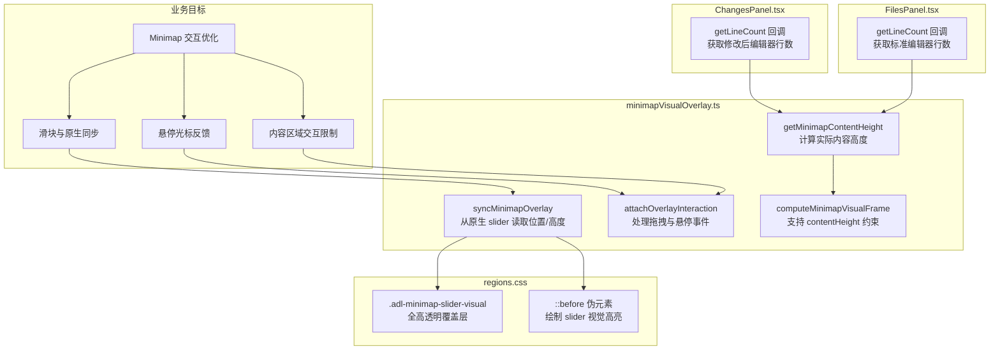

```mermaid
graph TD
    subgraph "minimapVisualOverlay.ts"
        direction TB
        
        subgraph "getSliderMetrics 函数"
            DOM["DOM 路径<br/>sliderRect.getBoundingClientRect()"]
            CSS["CSS 路径<br/>window.getComputedStyle()"]
            
            DOM -->|调用| Compute1["computeMetricsFromSlider<br/>(sliderHeight, sliderTop, minimapHeight)"]
            CSS -->|调用| Compute2["computeMetricsFromSlider<br/>(sliderHeight, sliderTop, minimapHeight)"]
        end
        
        subgraph "computeMetricsFromSlider 辅助函数"
            Validate["验证: sliderHeight > 0"]
            GetState["获取滚动状态<br/>getScrollState()"]
            CheckState["验证: scrollHeight > 0<br/>clientHeight > 0"]
            CalcMaxScroll["计算最大滚动<br/>maxScroll = scrollHeight - clientHeight"]
            CalcContentHeight["计算内容高度<br/>contentHeight = (sliderHeight / clientHeight) * scrollHeight"]
            Return["返回指标对象<br/>{sliderHeight, sliderTop, contentHeight, maxScroll}"]
            
            Validate -->|失败| Null1["返回 null"]
            Validate -->|成功| GetState
            GetState -->|失败| Null2["返回 null"]
            GetState -->|成功| CheckState
            CheckState -->|失败| Null3["返回 null"]
            CheckState -->|成功| CalcMaxScroll
            CalcMaxScroll -->|maxScroll <= 0| ReturnEdge["返回边缘情况指标"]
            CalcMaxScroll -->|maxScroll > 0| CalcContentHeight
            CalcContentHeight --> Return
        end
    end
    
    style Compute1 fill:#bbdefb,color:#0d47a1
    style Compute2 fill:#bbdefb,color:#0d47a1
    style computeMetricsFromSlider fill:#c8e6c9,color:#1a5e20
    style Return fill:#fff3e0,color:#e65100
    style Null1 fill:#ffcdd2,color:#c62828
    style Null2 fill:#ffcdd2,color:#c62828
    style Null3 fill:#ffcdd2,color:#c62828
```

## 1. 高层摘要 (TL;DR)

*   **影响范围**: **中等** - 重构了 Monaco Minimap 的视觉覆盖层交互系统,优化了滑块同步和内容区域交互
*   **核心变更**:
    -   🎯 Minimap slider 现在与 Monaco 原生滑块完全同步,位置和高度从 DOM 读取
    -   🖱️ 新增悬停光标反馈,鼠标移到 slider 上时显示抓取手势
    -   📏 添加内容区域交互限制,点击空白区域不会触发滚动
    -   🧪 大幅扩展测试覆盖,新增 200+ 行测试用例
    -   📄 清理了 6 个过期的规划文档

---

## 2. 可视化概览 (代码与逻辑映射)



---

## 3. 详细变更分析

### 3.1 核心逻辑重构 (`minimapVisualOverlay.ts`)

#### **变更类型**: 重大重构

**主要改进**:

| 功能 | 旧实现 | 新实现 |
|------|--------|--------|
| **滑块位置计算** | 基于 `scrollRatio` 算法计算 | 直接从 Monaco 原生 slider DOM 读取 `top` 和 `height` |
| **内容高度计算** | 固定使用 `minimapHeight` | 多级回退: canvas → `getLineCount` → slider 估算 → scrollRatio |
| **交互反馈** | 无悬停状态 | 新增 `--over-slider` 类,显示 `cursor: grab` |
| **内容区域限制** | 点击任意位置都可滚动 | 拒绝点击内容区域外的 `pointerdown` 事件 |

**关键代码变更**:

```typescript
// 旧实现: 基于 scrollRatio 计算
const frame = computeMinimapVisualFrame({
  minimapHeight,
  scrollRatio,
  visualHeight: readVisualHeight(minimap)
});

// 新实现: 从原生 slider 读取
const sliderRect = slider.getBoundingClientRect();
const sliderHeight = sliderRect.height;
const sliderTop = sliderRect.top - minimapRect.top;
overlay.style.setProperty("--adl-slider-top", `${sliderTop}px`);
overlay.style.setProperty("--adl-slider-height", `${sliderHeight}px`);
```

#### **新增函数**: `getMinimapContentHeight`

多级回退策略计算 minimap 实际内容高度:

1.  **优先级 1**: 从 canvas 元素读取高度 (`canvas.minimap-decorations-layer`)
2.  **优先级 2**: 使用 `getLineCount` 回调计算 (`lineCount * minimapLineHeight`)
3.  **优先级 3**: 基于 slider 高度估算 (`sliderHeight * scrollHeight / clientHeight`)
4.  **优先级 4**: 基于 scrollRatio 估算 (`minimapHeight * contentRatio`)

#### **新增函数**: `computeMinimapLineHeight`

根据 scale 参数计算 minimap 行高:
```typescript
export function computeMinimapLineHeight(scale: number): number {
  return Math.max(2, Math.round(2 * scale));
}
```

#### **交互优化**: 悬停光标反馈

```typescript
const isOverSlider = (clientY: number): boolean => {
  const { sliderTop, sliderHeight } = getOverlaySliderMetrics();
  const relativeY = clientY - minimapRect.top;
  return relativeY >= sliderTop && relativeY <= sliderTop + sliderHeight;
};

const handlePointerMove = (event: PointerEvent) => {
  if (!dragging) {
    if (isOverSlider(event.clientY)) {
      overlay.classList.add(OVER_SLIDER_CLASS); // 显示 grab 光标
    } else {
      overlay.classList.remove(OVER_SLIDER_CLASS); // 恢复默认光标
    }
    return;
  }
  // ... 拖拽逻辑
};
```

---

### 3.2 面板集成 (`ChangesPanel.tsx` & `FilesPanel.tsx`)

#### **变更类型**: 功能增强

**ChangesPanel.tsx**:
```typescript
attachMinimapVisualOverlays(changesPreviewShellRef.current, {
  // ... 其他选项
  getLineCount: () => getModifiedEditor()?.getModel?.()?.getLineCount() ?? null,
});
```

**FilesPanel.tsx**:
```typescript
// 类型定义扩展
type EditorLike = {
  // ... 现有属性
  getModel?(): { getLineCount(): number } | null;
};

// 回调实现
attachMinimapVisualOverlays(editorContainerRef.current, {
  // ... 其他选项
  getLineCount: () => getEditor()?.getModel?.()?.getLineCount() ?? null,
});
```

---

### 3.3 样式重构 (`regions.css`)

#### **变更类型**: 视觉优化

| 选择器 | 旧样式 | 新样式 | 说明 |
|--------|--------|--------|------|
| `.adl-minimap-slider-visual` | 动态 `top`/`height` | `top: 0; height: 100%` | 覆盖层改为全高透明 |
| `.adl-minimap-slider-visual` | 直接背景色 | `background: transparent` | 背景移到伪元素 |
| `.adl-minimap-slider-visual::before` | 不存在 | 新增 | 使用 CSS 变量绘制 slider 高亮 |
| `.adl-minimap-slider-visual:active` | `cursor: grabbing` | 移除 | 改用组合选择器 |

**关键 CSS 变更**:
```css
.adl-minimap-slider-visual {
  position: absolute;
  top: 0;           /* 新增: 固定顶部 */
  left: 0;
  right: 0;
  height: 100%;     /* 新增: 全高覆盖 */
  z-index: 4;
  border-radius: 0;
  background: transparent;  /* 改为透明 */
  cursor: default;
}

.adl-minimap-slider-visual--over-slider {
  cursor: grab;    /* 新增: 悬停显示抓取手势 */
}

.adl-minimap-slider-visual::before {
  content: "";
  position: absolute;
  left: 0;
  right: 0;
  top: var(--adl-slider-top, 0);        /* 从 JS 动态设置 */
  height: var(--adl-slider-height, 48px); /* 从 JS 动态设置 */
  background: color-mix(in srgb, var(--text-primary) calc(var(--adl-slider-intensity, 50%) * 0.28), transparent);
  pointer-events: none;  /* 确保不阻挡交互 */
  border-radius: 0;
}
```

---

### 3.4 测试覆盖扩展 (`minimapVisualOverlay.test.ts`)

#### **变更类型**: 测试增强

新增测试套件 (共 200+ 行):

| 测试套件 | 测试数量 | 覆盖功能 |
|----------|----------|----------|
| `computeMinimapVisualFrame` (扩展) | 5 | contentHeight 约束下的 slider 行为 |
| `computeMinimapLineHeight` | 5 | 不同 scale 下的行高计算 |
| `getMinimapContentHeight` | 11 | 多级回退策略验证 |
| `full-height overlay blocks Monaco native slider` | 5 | CSS 样式和伪元素验证 |
| `syncMinimapOverlay reads from native slider` | 3 | 从原生 slider 读取指标 |
| `attachOverlayInteraction uses native slider metrics` | 8 | 交互逻辑验证 |
| `getLineCount callback integration` | 6 | 回调集成验证 |
| `scrollToPointer uses native slider metrics` | 1 | 滚动计算验证 |

**关键测试示例**:

```typescript
it("constrains slider to contentHeight when content is shorter than minimap", () => {
  const frame = computeMinimapVisualFrame({
    minimapHeight: 600,
    scrollRatio: 1,
    visualHeight: 48,
    contentHeight: 120  // 内容仅 120px
  });
  expect(frame.top).toBe(72);  // 120 - 48 = 72 (slider 不能超出内容区域)
  expect(frame.height).toBe(48);
});

it("rejects pointerdown events outside content area", () => {
  expect(minimapOverlaySource).toContain("if (relativeY > metrics.contentHeight) return");
});
```

---

### 3.5 文档清理 (`.trae/documents/`)

#### **变更类型**: 文档删除

删除了 6 个已完成的规划文档:

| 文档 | 原因 |
|------|------|
| `changes-inline-minimap-optimization.md` | 功能已实现 |
| `custom-tooltip-component-plan.md` | 功能已实现 |
| `fix-context-menu-position.md` | 功能已实现 |
| `fix-diff-yellow-frames-and-minimap-colors.md` | 功能已实现 |
| `minimap-context-menu-and-diff-fix.md` | 功能已实现 |
| `simplify-theme-system.md` | 功能已实现 |

---

### 3.6 阶段边界更新 (`.trae/rules/phase-boundary.md`)

#### **变更类型**: 文档更新

更新了 Monaco Minimap 优化的描述:

```markdown
旧描述:
Monaco Minimap 优化（字符渲染、缩放、slider 高度约束、主题感知分层效果、深浅主题差异化阴影策略、自定义视觉覆盖层交互系统）

新描述:
Monaco Minimap 优化（滑块与原生同步、内容区域交互限制、悬停光标反馈、主题感知分层效果、深浅主题差异化阴影策略）
```

---

## 4. 影响与风险评估

### ⚠️ 破坏性变更

**无破坏性变更** - 所有变更为向后兼容的增强和重构。

### ✅ 测试建议

| 测试场景 | 验证要点 |
|----------|----------|
| **滑块同步** | 打开长文件,验证自定义 slider 位置与 Monaco 原生 slider 完全一致 |
| **悬停反馈** | 鼠标移到 minimap slider 上,验证光标变为 `grab` 手势 |
| **内容区域限制** | 点击 minimap 底部空白区域,验证不会触发滚动 |
| **短文件场景** | 打开短文件(内容不足一屏),验证 slider 高度正确且不能移动 |
| **拖拽体验** | 拖拽 minimap slider,验证编辑器滚动流畅,无抖动 |
| **主题切换** | 切换深浅主题,验证 slider 颜色正确 |
| **Diff 模式** | 在变更面板的内联 Diff 模式下,验证 minimap 功能正常 |

### 🔍 潜在风险

| 风险 | 影响 | 缓解措施 |
|------|------|----------|
| Monaco 版本差异导致 slider DOM 结构变化 | 中 | 使用 `querySelector` 查找,未找到时回退到旧算法 |
| `getLineCount` 回调返回 null | 低 | 多级回退策略确保总能计算 contentHeight |
| CSS 变量未正确设置 | 低 | 内联样式作为后备,确保 slider 可见 |
| 性能影响 (频繁 DOM 读取) | 低 | 仅在 `pointermove` 和 `syncAll` 时读取,已优化 |

---

## 5. 总结

本次变更显著提升了 Monaco Minimap 的用户体验:

1.  **更准确的滑块定位** - 直接从 Monaco 原生 slider 读取,消除了计算偏差
2.  **更直观的交互反馈** - 悬停显示抓取手势,拖拽体验更自然
3.  **更精确的内容边界** - 点击空白区域不会误触发滚动
4.  **更完善的测试覆盖** - 新增 200+ 行测试,确保功能稳定

所有变更均保持向后兼容,建议重点测试长文件、短文件和 Diff 模式下的 minimap 交互。

---

## 1. 高层摘要 (TL;DR)

*   **影响范围:** 🟡 **中等** - 重构了小地图视觉覆盖层的指标计算逻辑
*   **核心变更:**
    *   ✨ 新增 `computeMetricsFromSlider` 辅助函数，封装滑块指标计算逻辑
    *   ♻️ 消除 `getSliderMetrics` 函数中的重复代码
    *   ✅ 新增测试用例验证重构的正确性

## 2. 可视化概览 (代码与逻辑映射)



## 3. 详细变更分析

### 📦 组件：minimapVisualOverlay.ts

#### **变更内容：**
提取了重复的滑块指标计算逻辑到独立的辅助函数中，提高了代码的可维护性和可测试性。

**源文件：** `ai-digital-life/frontend/src/app/regions/right-panel/minimapVisualOverlay.ts`

#### **新增函数：computeMetricsFromSlider**

| 属性 | 值 |
|------|-----|
| **函数名** | `computeMetricsFromSlider` |
| **位置** | 第 222-237 行 |
| **参数** | `sliderHeight: number`, `sliderTop: number`, `minimapHeight: number` |
| **返回类型** | `{ sliderHeight, sliderTop, contentHeight, maxScroll } \| null` |

**功能说明：**
- **输入验证：** 检查 `sliderHeight` 是否大于 0
- **状态获取：** 调用 `getScrollState()` 获取滚动状态
- **边界处理：** 处理无滚动内容的情况（`maxScroll <= 0`）
- **核心计算：** 根据滑块比例计算实际内容高度
  ```typescript
  contentHeight = (sliderHeight / state.clientHeight) * state.scrollHeight
  ```

#### **重构：getSliderMetrics 函数**

| 代码路径 | 重构前 | 重构后 |
|---------|--------|--------|
| **DOM 路径** | 内联 17 行计算逻辑 | 调用 `computeMetricsFromSlider()` |
| **CSS 路径** | 内联 17 行计算逻辑 | 调用 `computeMetricsFromSlider()` |
| **代码行数** | ~34 行重复代码 | 2 行调用 + 16 行辅助函数 |

**消除的重复代码：**
- ❌ 滑块高度验证（`sliderHeight <= 0`）
- ❌ 滚动状态获取和验证
- ❌ 最大滚动距离计算
- ❌ 内容高度计算逻辑

---

### 🧪 组件：minimapVisualOverlay.test.ts

#### **变更内容：**
新增测试用例以验证重构的正确性和辅助函数的调用情况。

**源文件：** `ai-digital-life/frontend/src/app/regions/right-panel/minimapVisualOverlay.test.ts`

#### **新增测试用例：**

| 测试名称 | 验证目标 | 位置 |
|---------|---------|------|
| `extracts common logic into computeMetricsFromSlider helper` | 验证辅助函数存在且包含核心计算逻辑 | 第 633-636 行 |
| `computeMetricsFromSlider is called from both code paths` | 验证辅助函数在两个代码路径中都被调用 | 第 638-645 行 |

**测试逻辑：**
```typescript
// 验证辅助函数定义在两个调用之前
const helperIdx = source.indexOf("const computeMetricsFromSlider = ");
const domPathIdx = source.indexOf("computeMetricsFromSlider(...)");
const cssPathIdx = source.lastIndexOf("computeMetricsFromSlider(...)");
expect(helperIdx).toBeLessThan(domPathIdx);
expect(domPathIdx).toBeLessThan(cssPathIdx);
```

## 4. 影响与风险评估

### ⚠️ 破坏性变更
**无** - 这是一个纯重构变更，未改变外部 API 或行为。

### ✅ 测试建议

| 测试场景 | 验证内容 |
|---------|---------|
| **正常滚动** | 滑块拖动时，内容高度计算是否正确 |
| **无滚动内容** | 当 `maxScroll <= 0` 时，是否返回正确的边缘情况指标 |
| **无效滑块** | 当 `sliderHeight <= 0` 时，是否返回 `null` |
| **CSS 路径回退** | 当 DOM 路径失败时，CSS 路径是否能正确计算指标 |

### 🎯 重构收益

| 收益项 | 说明 |
|--------|------|
| **代码复用** | 消除了 34 行重复代码 |
| **可维护性** | 计算逻辑集中在一处，修改更容易 |
| **可测试性** | 辅助函数可独立测试 |
| **可读性** | `getSliderMetrics` 函数更简洁清晰 |