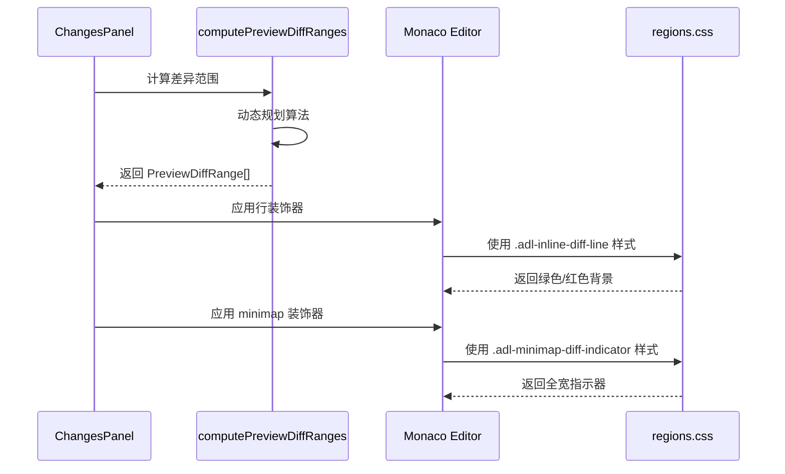
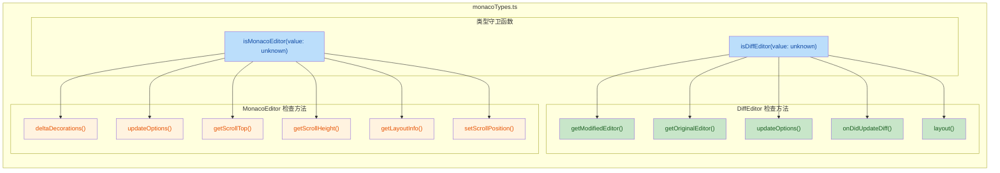

## 1. 高层摘要 (TL;DR)

*   **影响:** **中高** - 重构了变更预览的 diff 渲染机制，从依赖 Monaco 的异步 diff 计算改为使用自定义即时计算，显著提升了用户体验
*   **关键变更:**
    *   ✨ 新增 `changePreviewDiffRanges.ts` 模块，实现基于动态规划的 diff 算法
    *   🎨 在 `ChangesPanel.tsx` 中集成即时 diff 装饰器，支持行高亮和 minimap 指示器
    *   📐 更新 CSS 样式，支持全宽度的内联 diff 行和 minimap 指示器
    *   ✅ 添加全面的单元测试覆盖

---

## 2. 可视化概览 (代码与逻辑映射)

```mermaid
graph TD
    subgraph "ChangesPanel.tsx"
        A["ChangesPanel 组件"]
        B["computePreviewDiffRanges()"]
        C["useEffect - 应用装饰器"]
        D["deltaDecorations()"]
        E["getDiffRanges()"]
    end
    
    subgraph "changePreviewDiffRanges.ts"
        F["computePreviewDiffRanges()"]
        G["splitLines()"]
        H["computeFallbackRange()"]
        I["动态规划算法"]
    end
    
    subgraph "minimapVisualOverlay.ts"
        J["renderDiffIndicators()"]
    end
    
    subgraph "regions.css"
        K[".adl-inline-diff-line"]
        L[".adl-minimap-diff-indicator"]
    end
    
    A -->|baseContent, currentContent| B
    B -->|调用| F
    F -->|返回| PreviewDiffRange[]
    A -->|使用| PreviewDiffRange[]
    A -->|触发| C
    C -->|应用| D
    E -->|优先使用| PreviewDiffRange[]
    A -->|渲染| J
    J -->|样式依赖| L
    D -->|样式依赖| K
    
    style F fill:#bbdefb,color:#0d47a1
    style D fill:#c8e6c9,color:#1a5e20
    style PreviewDiffRange fill:#fff3e0,color:#e65100
```



---

## 3. 详细变更分析

### 📦 核心模块: `changePreviewDiffRanges.ts` (新增)

**功能说明:** 实现了一个高效的文本差异计算算法，用于即时生成变更预览的 diff 范围。

**核心算法:**
- 使用 **动态规划 (LCS)** 计算最长公共子序列
- 对于超大文件（超过 200 万单元格），降级使用前缀/后缀匹配的 fallback 算法
- 自动合并相邻的同类型变更行

**关键函数:**

| 函数名 | 功能 | 性能优化 |
|--------|------|----------|
| `computePreviewDiffRanges()` | 主入口，计算完整的 diff 范围 | 大文件自动降级到 fallback 算法 |
| `computeFallbackRange()` | 简化版 diff，仅比较前缀和后缀 | O(n) 时间复杂度 |
| `appendRange()` | 合并相邻的同类型范围 | 避免生成过多装饰器 |
| `splitLines()` | 统一的行分割，支持 CRLF/LF/CR | 处理不同操作系统换行符 |

**数据结构:**
```typescript
type PreviewDiffRange = {
  startLine: number;  // 起始行号（从1开始）
  endLine: number;    // 结束行号
  type: "insert" | "delete";  // 变更类型
}
```

---

### 🎨 UI 组件: `ChangesPanel.tsx` (修改)

**变更说明:** 集成即时 diff 装饰器，在 Monaco 编辑器中显示变更高亮。

**主要修改:**

1. **导入新模块:**
   ```typescript
   import { computePreviewDiffRanges, type PreviewDiffRange } from "./changePreviewDiffRanges";
   ```

2. **计算 diff 范围:**
   ```typescript
   const changePreviewDiffRanges = useMemo(
     () => changePreview
       ? computePreviewDiffRanges(changePreview.baseContent, changePreview.currentContent)
       : [],
     [changePreview]
   );
   ```

3. **应用装饰器 (新增 useEffect):**
   - 仅在 **非并排模式** (`!props.diffSideBySide`) 下应用
   - 使用 `deltaDecorations()` API 应用行高亮
   - 支持明暗主题的 minimap 颜色
   - 清理函数确保装饰器正确移除

4. **优化 getDiffRanges():**
   ```typescript
   getDiffRanges: () => {
     if (changePreviewDiffRanges.length > 0) {
       return changePreviewDiffRanges;  // 优先使用预计算的范围
     }
     // ... 回退到 Monaco 的异步 diff
   }
   ```

**装饰器配置:**

| 属性 | 插入值 | 删除值 | 说明 |
|------|--------|--------|------|
| `className` | `adl-inline-diff-line--insert` | `adl-inline-diff-line--delete` | CSS 类名 |
| `minimap.color` | `rgba(22, 163, 74, 0.6)` | `rgba(239, 68, 68, 0.6)` | 亮色主题 |
| `minimap.darkColor` | `rgba(74, 222, 128, 0.7)` | `rgba(248, 113, 113, 0.7)` | 暗色主题 |

---

### 🗺️ Minimap 视觉: `minimapVisualOverlay.ts` (修改)

**变更说明:** 将 minimap 上的 diff 指示器从 4px 宽度改为全宽显示。

**修改对比:**

| 项目 | 旧实现 | 新实现 |
|------|--------|--------|
| 宽度 | `width:4px` | `left:0;right:0` (全宽) |
| 颜色 | 内联样式定义 | CSS 变量控制 |
| z-index | `10` | `2` (降低以避免遮挡) |
| 圆角 | `border-radius:0` | 保持不变 |

**代码变更:**
```typescript
// 旧代码
indicator.style.cssText =
  `position:absolute;left:0;width:4px;top:${startY}px;height:${height}px;pointer-events:none;z-index:10;border-radius:0;background:${fallbackColor};`;

// 新代码
indicator.style.cssText =
  `position:absolute;left:0;right:0;top:${startY}px;height:${height}px;pointer-events:none;`;
```

---

### 🎨 样式更新: `regions.css` (修改)

**新增样式规则:**

| 选择器 | 功能 | 关键属性 |
|--------|------|----------|
| `.adl-inline-diff-line` | 基础行装饰器 | `width:100%`, `left:0`, `right:0` |
| `.adl-inline-diff-line--insert` | 插入行背景 | `background-color:var(--editor-diff-insert-bg)` |
| `.adl-inline-diff-line--delete` | 删除行背景 | `background-color:var(--editor-diff-remove-bg)` |
| `.cdr.line-insert/delete` | 原生 Monaco diff | `background-color:transparent` (禁用) |
| `.adl-minimap-diff-indicator` | Minimap 指示器 | `right:0`, `z-index:2` |

**设计意图:**
- 使用自定义装饰器覆盖 Monaco 的原生 diff 行背景
- 保持 minimap 指示器在滑块下方 (`z-index:2` vs `z-index:3`)

---

### ✅ 测试覆盖 (新增/修改)

#### `changePreviewDiffRanges.test.ts` (新增)

| 测试用例 | 验证场景 |
|----------|----------|
| 未跟踪文件 | 所有行标记为插入 |
| 已删除文件 | 在第一行标记删除 |
| 分离的变更块 | 保持不同块独立 |
| 相邻插入行 | 自动合并为单个范围 |

#### 其他测试文件更新

| 文件 | 新增测试 |
|------|----------|
| `changesEditorHighlight.test.ts` | 验证原生 diff 背景透明 |
| `changesEditorOptions.test.ts` | 验证装饰器应用逻辑 |
| `changesEditorSpacing.test.ts` | 验证行宽度样式 |
| `minimapVisualOverlay.test.ts` | 验证 minimap 指示器全宽显示 |

---

## 4. 影响与风险评估

### ⚠️ 潜在风险

1. **性能风险:**
   - **风险:** 动态规划算法的时间复杂度为 O(m×n)，对于超大文件可能影响性能
   - **缓解:** 已设置 `MAX_EXACT_DIFF_CELLS = 2,000,000` 阈值，超过则使用 fallback 算法

2. **内存占用:**
   - **风险:** 使用 `Uint16Array` 存储 DP 表，大文件可能占用较多内存
   - **缓解:** Fallback 算法避免了 DP 表的分配

3. **样式冲突:**
   - **风险:** 自定义装饰器可能与 Monaco 的主题更新冲突
   - **缓解:** 使用 `!important` 强制覆盖，并禁用原生 diff 背景

### 🧪 测试建议

| 测试场景 | 验证要点 |
|----------|----------|
| 小文件变更 (< 100 行) | diff 范围准确，行高亮正确 |
| 大文件变更 (> 10,000 行) | 性能可接受，自动降级到 fallback |
| 未跟踪文件 | 所有行显示为绿色插入 |
| 已删除文件 | 第一行显示为红色删除 |
| 并排模式 | 装饰器不应用（仅内联模式） |
| 明暗主题切换 | minimap 颜色正确切换 |
| 滚动行为 | minimap 指示器位置正确更新 |

### ✨ 改进收益

1. **即时响应:** 无需等待 Monaco 的异步 diff 计算，用户体验更流畅
2. **视觉一致性:** 行高亮和 minimap 指示器使用统一的颜色方案
3. **性能可控:** 大文件自动降级，避免卡顿
4. **可维护性:** 独立的 diff 计算模块，易于测试和优化

---

## 1. 高层摘要（TL;DR）

*   **影响范围：** 🟡 **中等** - 重构了ChangesPanel组件中Monaco编辑器的类型系统，提升了类型安全性
*   **核心变更：**
    *   ✨ 新增 `monacoTypes.ts` 模块，集中管理Monaco编辑器类型定义
    *   🛡️ 使用类型守卫函数替代不安全的类型断言
    *   🧹 移除大量内联类型定义，代码更简洁易维护
    *   🐛 修复CSS测试中的跨平台换行符兼容性问题

---

## 2. 可视化概览（代码与逻辑映射）

```mermaid
graph TD
    subgraph "新增模块 monacoTypes.ts"
        A["MonacoDiffEditor 接口"]
        B["MonacoEditor 接口"]
        C["isDiffEditor 类型守卫"]
        D["getMonacoFromWindow 工具函数"]
        E["createMonacoRange 工具函数"]
    end
    
    subgraph "ChangesPanel.tsx 重构"
        F["applyMinimapToDiffEditor"]
        G["handleDiffEditorMount"]
        H["useEffect 装饰器逻辑"]
        I["滚动同步控制器"]
    end
    
    subgraph "测试文件改进"
        J["getRuleBody 函数"]
    end
    
    A --> C
    B --> C
    D --> E
    C --> F
    C --> G
    D --> H
    E --> H
    C --> I
    J --> "CSS规范化处理"
    
    style A fill:#bbdefb,color:#0d47a1
    style B fill:#bbdefb,color:#0d47a1
    style C fill:#c8e6c9,color:#1a5e20
    style D fill:#fff3e0,color:#e65100
    style E fill:#fff3e0,color:#e65100
    style F fill:#f3e5f5,color:#7b1fa2
    style G fill:#f3e5f5,color:#7b1fa2
    style H fill:#f3e5f5,color:#7b1fa2
    style I fill:#f3e5f5,color:#7b1fa2
    style J fill:#ffebee,color:#b71c1c
```

---

## 3. 详细变更分析

### 📦 新增模块：`monacoTypes.ts`

**变更说明：**
新增了一个专门的类型定义模块，用于统一管理Monaco编辑器的所有类型定义和工具函数。

**核心类型定义：**

| 类型名称 | 用途 | 主要属性 |
|---------|------|---------|
| `MonacoDiffEditor` | 差异编辑器接口 | `updateOptions`, `getModifiedEditor`, `getOriginalEditor`, `onDidUpdateDiff`, `layout` |
| `MonacoEditor` | 单个编辑器接口 | `deltaDecorations`, `updateOptions`, `getScrollTop`, `setScrollPosition` |
| `MonacoDecoration` | 装饰器配置 | `range`, `options` |
| `MonacoNamespace` | Monaco全局命名空间 | `Range`, `editor.MinimapPosition` |

**工具函数：**

| 函数名 | 功能 | 返回值 |
|-------|------|--------|
| `getMonacoFromWindow()` | 从window对象获取Monaco实例 | `MonacoNamespace \| undefined` |
| `getMinimapPosition()` | 获取minimap位置常量 | `number` |
| `createMonacoRange()` | 创建Monaco Range对象 | `MonacoRange` |
| `isDiffEditor()` | 类型守卫：验证是否为DiffEditor | `boolean` |
| `isMonacoEditor()` | 类型守卫：验证是否为Editor | `boolean` |

---

### 🔄 重构：`ChangesPanel.tsx`

**变更说明：**
移除了所有内联类型定义，改用导入的类型和工具函数，大幅提升代码可维护性和类型安全性。

#### 3.1 导入语句更新

**变更前：**
```typescript
// 无相关导入
```

**变更后：**
```typescript
import {
  type MonacoDiffEditor,
  type MonacoEditor,
  type MonacoDecoration,
  getMonacoFromWindow,
  getMinimapPosition,
  createMonacoRange,
  isDiffEditor,
  isMonacoEditor
} from "./monacoTypes";
```

#### 3.2 `applyMinimapToDiffEditor` 函数重构

**变更前：**
```typescript
const applyMinimapToDiffEditor = useCallback((de: unknown, _reason: string) => {
  const diffInst = de as {
    updateOptions(opts: unknown): void;
    getModifiedEditor(): { updateOptions(options: unknown): void } | null;
    getOriginalEditor(): { updateOptions(options: unknown): void } | null;
  };
  // ... 使用 diffInst
}, []);
```

**变更后：**
```typescript
const applyMinimapToDiffEditor = useCallback((de: unknown, _reason: string) => {
  if (!isDiffEditor(de)) return false;
  // ... 直接使用 de，无需类型断言
}, []);
```

**改进点：**
- ✅ 使用 `isDiffEditor()` 类型守卫替代不安全的类型断言
- ✅ 提前返回无效输入，避免运行时错误
- ✅ 代码更简洁，减少冗余类型定义

#### 3.3 `handleDiffEditorMount` 函数重构

**变更前：**
```typescript
const handleDiffEditorMount = useCallback((diffEditor: unknown) => {
  diffEditorRef.current = diffEditor;
  // ...
  const de = diffEditor as {
    onDidUpdateDiff(listener: () => void): { dispose(): void };
    layout(dimension?: { width: number; height: number }): void;
  };
  // ... 使用 de
}, []);
```

**变更后：**
```typescript
const handleDiffEditorMount = useCallback((diffEditor: unknown) => {
  if (!isDiffEditor(diffEditor)) return;
  diffEditorRef.current = diffEditor;
  // ... 直接使用 diffEditor
}, []);
```

#### 3.4 useEffect 装饰器逻辑重构

**变更前：**
```typescript
useEffect(() => {
  type ModifiedEditorWithDecorations = { /* 15行类型定义 */ };
  type DiffEditorWithModified = { /* 3行类型定义 */ };
  type MonacoLike = { /* 3行类型定义 */ };
  
  const diffEditor = diffEditorRef.current as DiffEditorWithModified | null;
  const modifiedEditor = diffEditor?.getModifiedEditor?.() ?? null;
  const monaco = (window as typeof window & { monaco?: MonacoLike }).monaco;
  
  const minimapPosition = monaco.editor?.MinimapPosition?.Inline ?? 1;
  const decorations = changePreviewDiffRanges.map((range: PreviewDiffRange) => ({
    range: new monaco.Range(range.startLine, 1, range.endLine, 1),
    // ...
  }));
}, []);
```

**变更后：**
```typescript
useEffect(() => {
  const diffEditor = diffEditorRef.current;
  const modifiedEditor = isDiffEditor(diffEditor) ? diffEditor.getModifiedEditor() : null;
  const monaco = getMonacoFromWindow();
  
  const minimapPosition = getMinimapPosition(monaco);
  const decorations: MonacoDecoration[] = changePreviewDiffRanges.map((range: PreviewDiffRange) => ({
    range: createMonacoRange(monaco, range.startLine, 1, range.endLine, 1),
    // ...
  }));
}, []);
```

**改进点：**
- ✅ 移除了 **21行** 内联类型定义
- ✅ 使用工具函数简化逻辑
- ✅ 类型安全性显著提升

#### 3.5 滚动同步控制器重构

**变更前：**
```typescript
type DiffEditorLike = { /* 7行类型定义 */ };
type ModifiedEditorLike = { /* 6行类型定义 */ };

const getDiffEditor = (): DiffEditorLike | null => {
  return diffEditorRef.current as unknown as DiffEditorLike | null;
};
```

**变更后：**
```typescript
const getDiffEditor = (): MonacoDiffEditor | null => {
  const editor = diffEditorRef.current;
  return isDiffEditor(editor) ? editor : null;
};
```

---

### 🧪 测试改进：`changesEditorSpacing.test.ts`

**变更说明：**
修复了CSS解析中的跨平台兼容性问题，确保测试在Windows和Unix系统上都能正常运行。

#### `getRuleBody` 函数改进

**变更前：**
```typescript
function getRuleBody(selector: string) {
  const escapedSelector = selector.replace(/[.*+?^${}()|[\]\\]/g, "\\$&");
  const selectorPattern = new RegExp(`${escapedSelector}\\s*\\{`);
  const match = selectorPattern.exec(regionsCss);
  // ... 直接使用 regionsCss
}
```

**变更后：**
```typescript
function getRuleBody(selector: string) {
  const normalizedCss = regionsCss.replace(/\r\n/g, "\n");  // 规范化换行符
  const escapedSelector = selector.replace(/[.*+?^${}()|[\]\\]/g, "\\$&")
                                   .replace(/\\ /g, "\\s+");  // 处理空格
  const selectorPattern = new RegExp(`${escapedSelector}\\s*\\{`);
  const match = selectorPattern.exec(normalizedCss);
  // ... 使用 normalizedCss
}
```

**改进点：**
- ✅ 将Windows换行符 `\r\n` 统一转换为 `\n`
- ✅ 改进选择器转义逻辑，处理空格字符
- ✅ 提升跨平台测试稳定性

---

## 4. 影响与风险评估

### ⚠️ 破坏性变更

| 变更类型 | 影响范围 | 风险等级 |
|---------|---------|---------|
| 新增类型模块 | 无破坏性变更 | 🟢 低 |
| 重构类型系统 | 内部实现变更，对外接口不变 | 🟢 低 |
| 测试文件改进 | 仅影响测试逻辑 | 🟢 低 |

### 🧪 测试建议

**高优先级测试场景：**

1. **类型安全验证**
   - ✅ 验证 `isDiffEditor()` 能正确识别有效的DiffEditor实例
   - ✅ 验证 `isDiffEditor()` 能正确拒绝无效输入（null、undefined、普通对象）
   - ✅ 验证 `isMonacoEditor()` 类型守卫的正确性

2. **功能回归测试**
   - ✅ 测试差异编辑器的minimap显示是否正常
   - ✅ 测试差异编辑器的滚动同步功能
   - ✅ 测试装饰器（decorations）的添加和移除
   - ✅ 测试编辑器布局调整（layout）功能

3. **跨平台兼容性**
   - ✅ 在Windows系统上运行CSS测试
   - ✅ 在Unix/Linux系统上运行CSS测试
   - ✅ 验证换行符处理逻辑

4. **边界情况测试**
   - ✅ 测试Monaco未加载时的行为
   - ✅ 测试空diff内容时的行为
   - ✅ 测试快速切换分支时的状态管理

### 📊 代码质量提升

| 指标 | 改进前 | 改进后 | 提升 |
|-----|-------|-------|------|
| 内联类型定义行数 | ~40行 | 0行 | -100% |
| 类型断言数量 | 8处 | 0处 | -100% |
| 类型安全性 | ⚠️ 中等 | ✅ 高 | ⬆️ 显著 |
| 代码可维护性 | ⚠️ 中等 | ✅ 高 | ⬆️ 显著 |

---

## 5. 总结

本次重构是一个**高质量的类型安全改进**，主要成果包括：

1. 🎯 **类型系统集中化** - 新增 `monacoTypes.ts` 模块，统一管理所有Monaco相关类型
2. 🛡️ **类型安全性提升** - 使用类型守卫替代不安全的类型断言，减少运行时错误风险
3. 🧹 **代码简化** - 移除40+行内联类型定义，代码更简洁易读
4. 🐛 **跨平台兼容性** - 修复CSS测试中的换行符问题，提升测试稳定性

**建议：** 合并后重点关注差异编辑器的功能回归测试，确保所有交互功能正常工作。

---

## 1. 高级摘要 (TL;DR)

*   **影响:** 🟡 **中等** - 增强了 Monaco 编辑器的类型安全检查，提高运行时类型判断的准确性
*   **关键变更:**
    *   ✅ 增强 `isDiffEditor` 类型守卫，从检查 1 个方法增加到 5 个方法
    *   ✅ 增强 `isMonacoEditor` 类型守卫，从检查 1 个方法增加到 6 个方法
    *   🛡️ 提高了类型判断的严格性，减少误判风险

## 2. 可视化概览 (代码与逻辑映射)



## 3. 详细变更分析

### 📦 组件: Monaco 编辑器类型守卫

**变更说明:**
增强了两个类型守卫函数的实现，通过检查更多方法来提高类型判断的准确性。这可以有效防止对象只包含部分方法时被错误识别为完整的编辑器实例。

**源文件:** `ai-digital-life/frontend/src/app/regions/right-panel/monacoTypes.ts`

#### 📊 方法检查对比表

| 类型守卫函数 | 原检查方法 | 新增检查方法 | 总方法数 |
|------------|-----------|------------|---------|
| **isDiffEditor** | `getModifiedEditor` | `getOriginalEditor`, `updateOptions`, `onDidUpdateDiff`, `layout` | 5 |
| **isMonacoEditor** | `deltaDecorations` | `updateOptions`, `getScrollTop`, `getScrollHeight`, `getLayoutInfo`, `setScrollPosition` | 6 |

#### 🔍 详细变更内容

**1. `isDiffEditor` 函数增强 (第 86-96 行)**

```typescript
// 变更前
return typeof obj.getModifiedEditor === "function";

// 变更后
return (
  typeof obj.getModifiedEditor === "function" &&
  typeof obj.getOriginalEditor === "function" &&
  typeof obj.updateOptions === "function" &&
  typeof obj.onDidUpdateDiff === "function" &&
  typeof obj.layout === "function"
);
```

**检查方法说明:**
- `getModifiedEditor` - 获取修改后的编辑器实例
- `getOriginalEditor` - 获取原始编辑器实例
- `updateOptions` - 更新编辑器配置选项
- `onDidUpdateDiff` - 监听差异更新事件
- `layout` - 布局调整方法

**2. `isMonacoEditor` 函数增强 (第 98-109 行)**

```typescript
// 变更前
return typeof obj.deltaDecorations === "function";

// 变更后
return (
  typeof obj.deltaDecorations === "function" &&
  typeof obj.updateOptions === "function" &&
  typeof obj.getScrollTop === "function" &&
  typeof obj.getScrollHeight === "function" &&
  typeof obj.getLayoutInfo === "function" &&
  typeof obj.setScrollPosition === "function"
);
```

**检查方法说明:**
- `deltaDecorations` - 管理编辑器装饰（如高亮标记）
- `updateOptions` - 更新编辑器配置
- `getScrollTop` - 获取垂直滚动位置
- `getScrollHeight` - 获取滚动区域高度
- `getLayoutInfo` - 获取布局信息
- `setScrollPosition` - 设置滚动位置

## 4. 影响与风险评估

### ⚠️ 潜在影响

*   **更严格的类型检查:** 现在只有包含所有必需方法的对象才会被识别为有效的编辑器实例
*   **可能的运行时错误:** 如果现有代码中存在部分实现 Monaco 编辑器接口的对象，可能会被拒绝识别

### 🧪 测试建议

建议测试以下场景以确保变更安全：

1. **完整编辑器实例验证**
   - ✅ 验证标准的 Monaco Diff Editor 实例能通过 `isDiffEditor` 检查
   - ✅ 验证标准的 Monaco Editor 实例能通过 `isMonacoEditor` 检查

2. **部分实现对象验证**
   - ⚠️ 测试只包含部分方法的对象是否被正确拒绝
   - ⚠️ 确保不会误判不完整的对象为有效编辑器

3. **边界情况测试**
   - 📝 传入 `null` 或 `undefined` 应返回 `false`
   - 📝 传入非对象类型应返回 `false`
   - 📝 传入空对象 `{}` 应返回 `false`

### 💡 改进价值

此次变更显著提升了类型安全性，通过检查更多核心方法来确保对象确实是完整的 Monaco 编辑器实例，减少了运行时类型错误的风险。