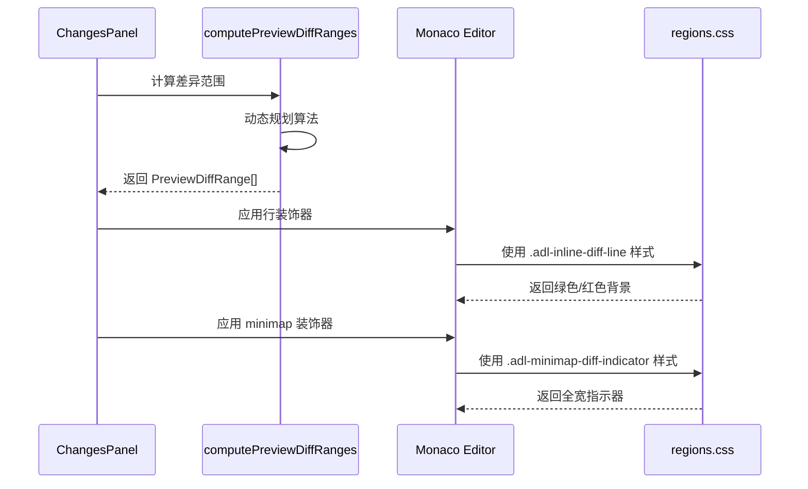

## 1. 高层摘要 (TL;DR)

*   **影响:** **中高** - 重构了变更预览的 diff 渲染机制，从依赖 Monaco 的异步 diff 计算改为使用自定义即时计算，显著提升了用户体验
*   **关键变更:**
    *   ✨ 新增 `changePreviewDiffRanges.ts` 模块，实现基于动态规划的 diff 算法
    *   🎨 在 `ChangesPanel.tsx` 中集成即时 diff 装饰器，支持行高亮和 minimap 指示器
    *   📐 更新 CSS 样式，支持全宽度的内联 diff 行和 minimap 指示器
    *   ✅ 添加全面的单元测试覆盖

---

## 2. 可视化概览 (代码与逻辑映射)

```mermaid
graph TD
    subgraph "ChangesPanel.tsx"
        A["ChangesPanel 组件"]
        B["computePreviewDiffRanges()"]
        C["useEffect - 应用装饰器"]
        D["deltaDecorations()"]
        E["getDiffRanges()"]
    end
    
    subgraph "changePreviewDiffRanges.ts"
        F["computePreviewDiffRanges()"]
        G["splitLines()"]
        H["computeFallbackRange()"]
        I["动态规划算法"]
    end
    
    subgraph "minimapVisualOverlay.ts"
        J["renderDiffIndicators()"]
    end
    
    subgraph "regions.css"
        K[".adl-inline-diff-line"]
        L[".adl-minimap-diff-indicator"]
    end
    
    A -->|baseContent, currentContent| B
    B -->|调用| F
    F -->|返回| PreviewDiffRange[]
    A -->|使用| PreviewDiffRange[]
    A -->|触发| C
    C -->|应用| D
    E -->|优先使用| PreviewDiffRange[]
    A -->|渲染| J
    J -->|样式依赖| L
    D -->|样式依赖| K
    
    style F fill:#bbdefb,color:#0d47a1
    style D fill:#c8e6c9,color:#1a5e20
    style PreviewDiffRange fill:#fff3e0,color:#e65100
```



---

## 3. 详细变更分析

### 📦 核心模块: `changePreviewDiffRanges.ts` (新增)

**功能说明:** 实现了一个高效的文本差异计算算法，用于即时生成变更预览的 diff 范围。

**核心算法:**
- 使用 **动态规划 (LCS)** 计算最长公共子序列
- 对于超大文件（超过 200 万单元格），降级使用前缀/后缀匹配的 fallback 算法
- 自动合并相邻的同类型变更行

**关键函数:**

| 函数名 | 功能 | 性能优化 |
|--------|------|----------|
| `computePreviewDiffRanges()` | 主入口，计算完整的 diff 范围 | 大文件自动降级到 fallback 算法 |
| `computeFallbackRange()` | 简化版 diff，仅比较前缀和后缀 | O(n) 时间复杂度 |
| `appendRange()` | 合并相邻的同类型范围 | 避免生成过多装饰器 |
| `splitLines()` | 统一的行分割，支持 CRLF/LF/CR | 处理不同操作系统换行符 |

**数据结构:**
```typescript
type PreviewDiffRange = {
  startLine: number;  // 起始行号（从1开始）
  endLine: number;    // 结束行号
  type: "insert" | "delete";  // 变更类型
}
```

---

### 🎨 UI 组件: `ChangesPanel.tsx` (修改)

**变更说明:** 集成即时 diff 装饰器，在 Monaco 编辑器中显示变更高亮。

**主要修改:**

1. **导入新模块:**
   ```typescript
   import { computePreviewDiffRanges, type PreviewDiffRange } from "./changePreviewDiffRanges";
   ```

2. **计算 diff 范围:**
   ```typescript
   const changePreviewDiffRanges = useMemo(
     () => changePreview
       ? computePreviewDiffRanges(changePreview.baseContent, changePreview.currentContent)
       : [],
     [changePreview]
   );
   ```

3. **应用装饰器 (新增 useEffect):**
   - 仅在 **非并排模式** (`!props.diffSideBySide`) 下应用
   - 使用 `deltaDecorations()` API 应用行高亮
   - 支持明暗主题的 minimap 颜色
   - 清理函数确保装饰器正确移除

4. **优化 getDiffRanges():**
   ```typescript
   getDiffRanges: () => {
     if (changePreviewDiffRanges.length > 0) {
       return changePreviewDiffRanges;  // 优先使用预计算的范围
     }
     // ... 回退到 Monaco 的异步 diff
   }
   ```

**装饰器配置:**

| 属性 | 插入值 | 删除值 | 说明 |
|------|--------|--------|------|
| `className` | `adl-inline-diff-line--insert` | `adl-inline-diff-line--delete` | CSS 类名 |
| `minimap.color` | `rgba(22, 163, 74, 0.6)` | `rgba(239, 68, 68, 0.6)` | 亮色主题 |
| `minimap.darkColor` | `rgba(74, 222, 128, 0.7)` | `rgba(248, 113, 113, 0.7)` | 暗色主题 |

---

### 🗺️ Minimap 视觉: `minimapVisualOverlay.ts` (修改)

**变更说明:** 将 minimap 上的 diff 指示器从 4px 宽度改为全宽显示。

**修改对比:**

| 项目 | 旧实现 | 新实现 |
|------|--------|--------|
| 宽度 | `width:4px` | `left:0;right:0` (全宽) |
| 颜色 | 内联样式定义 | CSS 变量控制 |
| z-index | `10` | `2` (降低以避免遮挡) |
| 圆角 | `border-radius:0` | 保持不变 |

**代码变更:**
```typescript
// 旧代码
indicator.style.cssText =
  `position:absolute;left:0;width:4px;top:${startY}px;height:${height}px;pointer-events:none;z-index:10;border-radius:0;background:${fallbackColor};`;

// 新代码
indicator.style.cssText =
  `position:absolute;left:0;right:0;top:${startY}px;height:${height}px;pointer-events:none;`;
```

---

### 🎨 样式更新: `regions.css` (修改)

**新增样式规则:**

| 选择器 | 功能 | 关键属性 |
|--------|------|----------|
| `.adl-inline-diff-line` | 基础行装饰器 | `width:100%`, `left:0`, `right:0` |
| `.adl-inline-diff-line--insert` | 插入行背景 | `background-color:var(--editor-diff-insert-bg)` |
| `.adl-inline-diff-line--delete` | 删除行背景 | `background-color:var(--editor-diff-remove-bg)` |
| `.cdr.line-insert/delete` | 原生 Monaco diff | `background-color:transparent` (禁用) |
| `.adl-minimap-diff-indicator` | Minimap 指示器 | `right:0`, `z-index:2` |

**设计意图:**
- 使用自定义装饰器覆盖 Monaco 的原生 diff 行背景
- 保持 minimap 指示器在滑块下方 (`z-index:2` vs `z-index:3`)

---

### ✅ 测试覆盖 (新增/修改)

#### `changePreviewDiffRanges.test.ts` (新增)

| 测试用例 | 验证场景 |
|----------|----------|
| 未跟踪文件 | 所有行标记为插入 |
| 已删除文件 | 在第一行标记删除 |
| 分离的变更块 | 保持不同块独立 |
| 相邻插入行 | 自动合并为单个范围 |

#### 其他测试文件更新

| 文件 | 新增测试 |
|------|----------|
| `changesEditorHighlight.test.ts` | 验证原生 diff 背景透明 |
| `changesEditorOptions.test.ts` | 验证装饰器应用逻辑 |
| `changesEditorSpacing.test.ts` | 验证行宽度样式 |
| `minimapVisualOverlay.test.ts` | 验证 minimap 指示器全宽显示 |

---

## 4. 影响与风险评估

### ⚠️ 潜在风险

1. **性能风险:**
   - **风险:** 动态规划算法的时间复杂度为 O(m×n)，对于超大文件可能影响性能
   - **缓解:** 已设置 `MAX_EXACT_DIFF_CELLS = 2,000,000` 阈值，超过则使用 fallback 算法

2. **内存占用:**
   - **风险:** 使用 `Uint16Array` 存储 DP 表，大文件可能占用较多内存
   - **缓解:** Fallback 算法避免了 DP 表的分配

3. **样式冲突:**
   - **风险:** 自定义装饰器可能与 Monaco 的主题更新冲突
   - **缓解:** 使用 `!important` 强制覆盖，并禁用原生 diff 背景

### 🧪 测试建议

| 测试场景 | 验证要点 |
|----------|----------|
| 小文件变更 (< 100 行) | diff 范围准确，行高亮正确 |
| 大文件变更 (> 10,000 行) | 性能可接受，自动降级到 fallback |
| 未跟踪文件 | 所有行显示为绿色插入 |
| 已删除文件 | 第一行显示为红色删除 |
| 并排模式 | 装饰器不应用（仅内联模式） |
| 明暗主题切换 | minimap 颜色正确切换 |
| 滚动行为 | minimap 指示器位置正确更新 |

### ✨ 改进收益

1. **即时响应:** 无需等待 Monaco 的异步 diff 计算，用户体验更流畅
2. **视觉一致性:** 行高亮和 minimap 指示器使用统一的颜色方案
3. **性能可控:** 大文件自动降级，避免卡顿
4. **可维护性:** 独立的 diff 计算模块，易于测试和优化

---