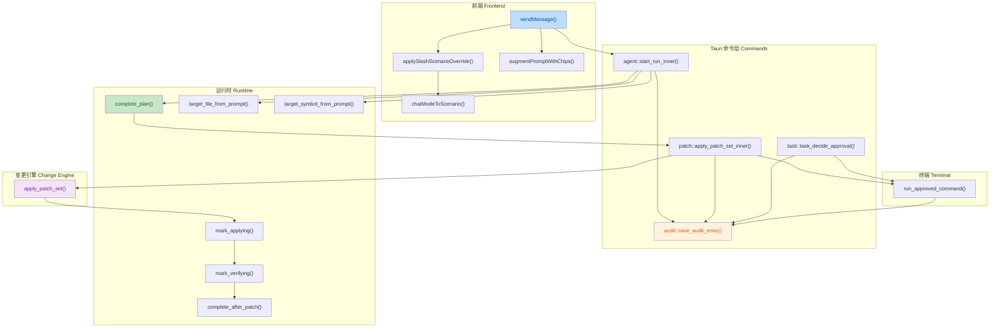
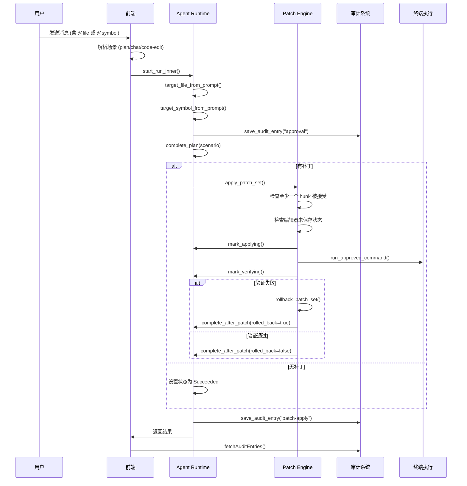

## 1. 高层摘要 (TL;DR)

- **影响:** 🔴 **高** - 重构了补丁应用流程,新增完整的审计追踪系统,改进了对话场景处理
- **核心变更:**
  - ✨ 新增 `AuditEntry` 类型及完整的审计记录系统,追踪所有关键操作(补丁应用、回滚、命令执行、审批决策)
  - 🔧 重构补丁应用状态机:新增 `Applying`、`Verifying`、`RolledBack` 等状态,实现更精细的流程控制
  - 📝 改进对话场景处理:支持 `Plan`/`Chat`/`CodeEdit` 三种模式,根据场景动态调整补丁生成和状态
  - 🛡️ 增强安全性:补丁应用前检查编辑器未保存状态,要求至少接受一个 hunk 才能应用
  - 💬 前端支持斜杠命令 (`/apply`, `/rollback`, `/model`, `/clear`) 和上下文芯片

---

## 2. 可视化概览 (代码与逻辑映射)

---

## 3. 详细变更分析

### 📦 核心类型与数据结构

#### 新增审计类型

| 类型 | 字段 | 说明 |
|------|------|------|
| `AuditEntry` | `id`, `timestamp`, `operation_type`, `summary`, `risk_level`, `decision`, `detail` | 统一的审计记录结构,用于追踪所有关键操作 |

**来源:** `ai-digital-life/crates/kernel/src/types.rs`

---

### 🤖 Agent Runtime 层

#### 补丁状态管理增强

**新增函数:**
- `mark_applying(detail)` - 标记补丁应用中状态
- `mark_verifying(detail)` - 标记验证中状态  
- `complete_after_patch(detail, validation, rolled_back)` - 补丁完成后根据验证结果设置最终状态

**重构函数:**
- `complete_plan(detail, patch_set, scenario)` - 新增 `scenario` 参数,根据不同场景设置不同状态:
  - **CodeEdit + 有补丁:** `Ready` - "补丁预览已生成,请在变更面板中审阅并按需应用"
  - **Plan/Chat + 无补丁:** `Succeeded` - "模型响应完成(本轮无补丁)"
  - **CodeEdit + 无补丁:** `Ready` - "未解析到 @file 目标;请使用 @file:path 提议补丁,或使用 Plan/Ask 模式"

**来源:** `ai-digital-life/crates/agent-runtime/src/lib.rs`

#### 提示词解析改进

**重构函数:**
- `target_file_from_prompt(prompt)` - 改进文件路径解析:
  - 支持 `@file:path` 显式语法
  - 支持 `@path/to/file` 松散语法
  - 过滤 `@symbol:` 引用
  
**新增函数:**
- `target_symbol_from_prompt(prompt)` - 提取 `@symbol:name` 引用

**来源:** `ai-digital-life/crates/agent-runtime/src/lib.rs`

#### 对话块生成改进

**重构函数:**
- `assistant_blocks(detail, patch_set, scenario)` - 根据场景显示不同标题:
  - `Plan` → "执行计划"
  - `Chat` → "对话"
  - `CodeEdit` → "单 Agent 步骤"

**来源:** `ai-digital-life/crates/agent-runtime/src/lib.rs`

---

### 🔧 变更引擎层

#### 补丁应用安全增强

**变更内容:**
- `apply_patch_set()` 新增验证逻辑:
  - **必须至少有一个 hunk 被接受**才能应用补丁
  - 否则返回错误: "No patch hunks were accepted. Accept at least one hunk before applying."

**来源:** `ai-digital-life/crates/change-engine/src/lib.rs`

---

### 📝 上下文引擎层

#### 新增上下文类型

**新增函数:**
- `symbol_context(symbol_name)` - 为 `@symbol:` 引用创建上下文条目
- `outline_context(path, items, max_items)` - 为文件大纲创建上下文
- `search_hit_contexts(query, hits, max_hits)` - 为搜索结果创建上下文条目

**优先级更新:**
- `sort_context()` 新增 `symbol` 类型优先级(位于 `file` 之后,`outline` 之前)

**来源:** `ai-digital-life/crates/context-engine/src/lib.rs`

---

### 🖥️ 终端执行层

#### 命令执行权限控制

**重构内容:**
- `run_command()` → `run_command_internal()` - 内部实现,新增 `approval_granted` 参数
- `run_approved_command()` - 新增公共接口,用于执行已批准的命令(绕过风险检查)

**来源:** `ai-digital-life/crates/terminal/src/lib.rs`

---

### 🎨 前端层

#### 消息发送增强

**新增模块:** `composerSend.ts`

| 函数 | 功能 |
|------|------|
| `chatModeToScenario(mode)` | 映射 UI 模式到后端场景 (plan→plan, ask→chat, debug→code-edit) |
| `augmentPromptWithChips(content, chips)` | 将上下文芯片以低优先级附注形式拼入用户内容 |
| `applySlashScenarioOverride(content, base)` | 处理斜杠命令前缀 (`/plan`, `/edit`, `/chat`, `/ask`) |

**来源:** `ai-digital-life/frontend/src/app/composerSend.ts`

#### Store 更新

**`sendMessage()` 增强:**
- 新增 `options` 参数支持 `mode` 和 `chips`
- 支持斜杠命令:
  - `/apply` - 应用当前补丁
  - `/rollback` - 回滚当前补丁
  - `/model` - 打开模型面板
  - `/clear` - 显示未实现提示

**审计集成:**
- 在 `applyPatchSet()`, `rollbackPatchSet()`, `refreshTaskCenter()`, `runCommand()` 等操作后调用 `fetchAuditEntries(40)`

**来源:** `ai-digital-life/frontend/src/app/store.ts`

---

### 🔌 Tauri 命令层

#### 审计模块新增

**新增模块:** `commands/audit.rs`

| 函数 | 功能 |
|------|------|
| `save_audit_entry(state, workspace_id, session_id, operation_type, risk_level, summary, decision, detail)` | 保存审计条目 |
| `list_audit_entries(state, limit)` | 查询审计条目(按时间倒序) |

**来源:** `ai-digital-life/src-tauri/src/commands/audit.rs`

#### Agent 命令增强

**`start_run_inner()` 改进:**
- 新增审计记录: Agent 运行启动
- 增强上下文处理:
  - 解析 `@file:` 引用 → 读取文件内容 + 文件大纲
  - 解析 `@symbol:` 引用 → 符号上下文 + 搜索结果
- 根据场景决定是否创建补丁集(仅 `CodeEdit` 模式创建)
- 新增审计记录: 补丁生成/运行更新

**来源:** `ai-digital-life/src-tauri/src/commands/agent.rs`

#### 补丁命令增强

**`apply_patch_set_inner()` 改进:**
- **安全检查:** 检查编辑器中是否有未保存修改,如有则拒绝应用
- 状态更新: `mark_applying()` → 应用补丁 → `mark_verifying()` → 验证
- 审计记录: 补丁应用、验证命令执行、自动回滚

**`patch_rollback_patch_set()` 改进:**
- 新增审计记录: 用户请求回滚
- 更新关联的 `AgentRunDetail` 状态为 `RolledBack`

**来源:** `ai-digital-life/src-tauri/src/commands/patch.rs`

#### 任务命令增强

**`task_decide_approval()` 重构:**
- 改为异步函数
- 新增 `maybe_execute_approved_command()` - 自动执行已批准的命令
- 新增审计记录: 审批决策

**新增命令:**
- `task_list_audit_entries(limit)` - 查询审计条目

**来源:** `ai-digital-life/src-tauri/src/commands/task.rs`

#### 命令执行增强

**`command_run_inner()` / `command_run_stream_inner()` 改进:**
- 新增审计记录: 命令审批请求、命令执行结果

**来源:** `ai-digital-life/src-tauri/src/commands/command.rs`

---

## 4. 影响与风险评估

### ⚠️ 破坏性变更

| 变更类型 | 影响范围 | 说明 |
|---------|---------|------|
| **函数签名变更** | `agent-runtime` | `complete_plan()` 新增必需参数 `scenario` |
| **函数签名变更** | `agent-runtime` | `assistant_blocks()` 新增必需参数 `scenario` |
| **API 新增** | Frontend | `sendMessage()` 新增可选 `options` 参数(向后兼容) |

### 🧪 测试建议

#### 核心流程测试
- ✅ **补丁应用流程:**
  - 验证至少接受一个 hunk 才能应用
  - 验证编辑器未保存时拒绝应用
  - 验证验证失败时自动回滚
  - 验证回滚后状态正确更新为 `RolledBack`

- ✅ **对话场景测试:**
  - `Plan` 模式: 无补丁时状态为 `Succeeded`
  - `Chat` 模式: 无补丁时状态为 `Succeeded`
  - `CodeEdit` 模式: 有 `@file:` 时生成补丁,无时提示错误

- ✅ **斜杠命令测试:**
  - `/apply` 应用当前补丁
  - `/rollback` 回滚当前补丁
  - `/plan`, `/edit`, `/chat` 前缀覆盖当前模式

- ✅ **审计追踪测试:**
  - 验证所有关键操作都生成审计条目
  - 验证审计条目按时间倒序排列
  - 验证审计条目包含正确的风险级别和决策信息

#### 边界情况测试
- 🧪 空补丁集应用
- 🧪 所有 hunk 被拒绝的补丁集
- 🧪 编辑器中有多个未保存文件
- 🧪 验证命令超时
- 🧪 并发补丁应用

---

## 5. 文档更新

**更新文档:** `docs/architecture/task-governance.md`

**新增内容:**
- ✅ 审计时间线条目可从渲染器查询,审批、补丁应用/回滚、验证和命令执行可共享一个审查界面
- ⚠️ 已批准的流式命令尚未在审批后恢复为实时流,目前通过捕获的后端执行路径完成

**来源:** `ai-digital-life/docs/architecture/task-governance.md`

---

验证问题的存在性并进行修复：

标题: 审计日志保存错误处理不完善
详情: 使用`let _ = crate::commands::audit::save_audit_entry(...)`忽略了可能的错误。建议至少记录错误日志：`if let Err(e) = crate::commands::audit::save_audit_entry(...) { log::warn!("审计日志保存失败: {}", e); }`
`ai-digital-life/src-tauri/src/commands/agent.rs#L86-95`