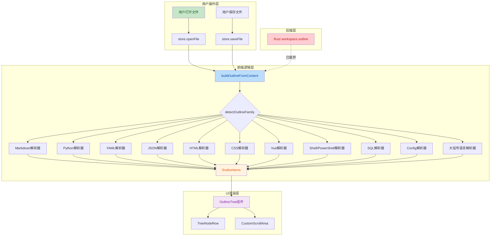

## 1. 高层摘要 (TL;DR)

*   **影响范围：** 🟡 **中高** - 重构了代码大纲解析的核心架构，涉及前后端多个模块
*   **核心变更：**
    *   🔄 将代码大纲解析从 Rust 后端迁移到 TypeScript 前端，支持更多语言和更精确的层次结构
    *   ✨ 新增 12 种文件类型的解析器（Markdown, Python, YAML, JSON, HTML, CSS, Vue, Shell, PowerShell, SQL, Config, 大括号语言）
    *   🧩 抽取可复用组件（`CustomScrollArea`, `TreeNodeRow`），重构 `FileTree` 和新增 `OutlineTree` 组件
    *   📊 扩展 `FileOutlineItem` 类型，增加 `endLine`, `depth` 等字段以支持嵌套结构

---

## 2. 可视化概览 (代码与逻辑映射)



---

## 3. 详细变更分析

### 3.1 核心架构：代码大纲解析迁移

#### 📝 变更说明
将代码大纲解析逻辑从 Rust 后端完全迁移到前端 TypeScript，实现更强大的多语言支持和更精细的层次结构分析。

#### 🔧 关键文件

| 文件路径 | 变更类型 | 说明 |
|---------|---------|------|
| `frontend/src/shared/outline.ts` | **新增** | 核心解析逻辑，696 行代码 |
| `crates/workspace/src/lib.rs` | **重构** | `outline()` 函数被简化（保留用于其他用途） |
| `frontend/src/app/store.ts` | **修改** | 移除后端调用，改用前端解析 |
| `frontend/src/kernel/index.ts` | **扩展** | `FileOutlineItem` 类型增加字段 |

#### 📊 支持的语言类型对比

| 语言类别 | 文件扩展名 | 解析器函数 | 新增功能 |
|---------|-----------|-----------|---------|
| Markdown | `.md`, `.markdown` | `pushMarkdownOutline` | 支持 H1-H6，跳过代码块 |
| Python | `.py` | `parsePython` | 基于缩进的类/函数识别 |
| YAML | `.yaml`, `.yml` | `parseYaml` | 键值对和列表项识别 |
| JSON | `.json` | `parseJson` | 嵌套对象键识别 |
| HTML | `.html`, `.htm`, `.xml`, `.svg` | `parseHtml` | 结构化标签 + id/class 属性 |
| CSS | `.css`, `.scss`, `.less` | `parseCss` | 选择器和规则识别 |
| Vue | `.vue` | `parseVue` | 模板、脚本、样式块识别 |
| Shell | `.sh`, `.bash`, `.zsh`, `.fish`, `Dockerfile` | `parseShell` | 函数和别名识别 |
| PowerShell | `.ps1` | `parseShell` | Cmdlet 和函数识别 |
| SQL | `.sql` | `parseSql` | 表、视图、存储过程识别 |
| Config | `.toml`, `.ini`, `.cfg`, `.conf` | `parseConfig` | 节和键值对识别 |
| 大括号语言 | `.js`, `.ts`, `.rs`, `.go`, `.c#` 等 | `parseBraceLanguage` | 20+ 正则匹配规则 |

#### 🆕 新增的大纲项类型

```typescript
// 旧版本 (仅 6 种)
kind: "function" | "class" | "interface" | "type" | "const" | "heading"

// 新版本 (10 种)
kind: "function" | "class" | "interface" | "type" | "const" | "heading" 
     | "variable" | "method" | "property" | "enum" | "enum-member"
```

#### 📦 扩展的数据结构

```typescript
export interface FileOutlineItem {
  id: string;
  label: string;
  kind: FileOutlineItem["kind"];
  line: number;
  endLine?: number;      // 🆕 大纲项的结束行号
  depth?: number;        // 🆕 嵌套深度
  icon?: string;         // 🆕 图标标识
  children?: FileOutlineItem[]; // 🆕 子节点
}
```

#### 💡 核心解析逻辑示例（大括号语言）

```typescript
// 检测语言家族
function detectOutlineFamily(relativePath: string): OutlineFamily {
  const extension = extensionOf(relativePath);
  if (extension === "py") return "python";
  if (extension === "yaml" || extension === "yml") return "yaml";
  // ... 其他语言判断
  return "brace"; // 默认使用大括号解析器
}

// 大括号语言解析（支持 JS/TS/Rust/Go/C# 等）
function parseBraceLanguage(content: string): OutlineDraft[] {
  let braceDepth = 0;
  return content.split(/\r?\n/).flatMap((lineText, index) => {
    const sanitized = sanitizeBraceLine(lineText); // 移除字符串和注释
    const effectiveBraceDepth = Math.max(0, braceDepth - countLeadingClosers(sanitized, "}]"));
    
    // 使用 20+ 正则规则匹配
    for (const matcher of BRACE_MATCHERS) {
      const match = trimmed.match(matcher.pattern);
      if (match?.[1]) {
        return [{
          label: match[1],
          kind: matcher.kind,
          line: index + 1,
          depth: effectiveBraceDepth + 1
        }];
      }
    }
    
    braceDepth += countChars(sanitized, "{[") - countChars(sanitized, "}]");
    return [];
  });
}
```

---

### 3.2 UI 组件重构与新增

#### 🧩 新增可复用组件

| 组件 | 文件 | 功能 | 复用场景 |
|-----|------|------|---------|
| `CustomScrollArea` | `CustomScrollArea.tsx` | 自定义滚动条 | FileTree, OutlineTree |
| `TreeNodeRow` | `TreeNodeRow.tsx` | 通用树节点行 | FileTree, OutlineTree |
| `OutlineTree` | `OutlineTree.tsx` | 代码大纲树 | 右侧面板大纲视图 |

#### 📋 TreeNodeRow 组件特性

```typescript
interface TreeNodeRowProps {
  depth: number;              // 嵌套深度
  rowOffset: number;          // 行偏移量（用于缩进）
  hasChildren: boolean;       // 是否有子节点
  isExpanded?: boolean;      // 是否展开
  isActive?: boolean;        // 是否激活
  expandLabel: string;        // "展开" 无障碍标签
  collapseLabel: string;     // "折叠" 无障碍标签
  onToggle?: () => void;     // 展开/折叠回调
  onActivate: () => void;    // 激活回调
  // ... 其他样式和事件处理属性
}
```

#### 🔄 FileTree 重构要点

**变更前：**
- 内联实现滚动条逻辑（~80 行代码）
- 使用 `<button>` 作为树节点容器
- 直接渲染图标和标签

**变更后：**
- 使用 `CustomScrollArea` 组件
- 使用 `TreeNodeRow` 组件统一渲染
- 分离关注点，提升可维护性

```typescript
// 变更示例
// 旧代码
<button onClick={() => isDirectory ? onToggle(node.path) : onOpenFile(node.path)}>
  <IconChevronDown />
  <span>{node.name}</span>
</button>

// 新代码
<TreeNodeRow
  depth={depth + 1}
  hasChildren={isDirectory}
  isExpanded={isExpanded}
  expandLabel={expandLabel}
  collapseLabel={collapseLabel}
  onToggle={isDirectory ? () => onToggle(node.path) : undefined}
  onActivate={() => (isDirectory ? onToggle(node.path) : onOpenFile(node.path))}
  label={node.name}
/>
```

---

### 3.3 数据模型与状态管理

#### 🏪 Store 变更 (`store.ts`)

| 方法 | 变更前 | 变更后 |
|-----|-------|-------|
| `openFile` | 并行调用 `readFile` 和 `outline` | 仅调用 `readFile`，前端解析大纲 |
| `saveFile` | 调用后端 `outline` | 使用前端 `buildOutlineFromContent` |

```typescript
// 变更前
openFile: async (relativePath: string) => {
  const [fileResult, outlineResult] = await Promise.all([
    window.digitalLife.workspace.readFile(relativePath),
    window.digitalLife.workspace.outline(relativePath)  // ❌ 后端调用
  ]);
  // ...
  outline: outlineResult.ok ? outlineResult.data : []
}

// 变更后
openFile: async (relativePath: string) => {
  const fileResult = await window.digitalLife.workspace.readFile(relativePath);
  // ...
  const nextOutline = buildOutlineFromContent(fileResult.data.content, relativePath); // ✅ 前端解析
  outline: nextOutline
}
```

---

### 3.4 其他改进

#### 🐛 Bug 修复：文件名显示

**文件：** `changesTree.ts`

```typescript
// 变更前
name: entry.path,  // 显示完整路径 "src/components/Button.tsx"

// 变更后
const name = entry.path.split("/").filter(Boolean).pop() ?? entry.path;
name,  // 只显示文件名 "Button.tsx"
```

#### 🔧 语言支持扩展

**文件：** `cmLanguages.ts`

| 新增语言 | 映射到 | 用途 |
|---------|-------|------|
| `config` | `yaml()` | 配置文件语法高亮 |
| `vue` | `html()` | Vue 单文件组件 |

---

## 4. 影响与风险评估

### ⚠️ 破坏性变更

| 变更项 | 影响范围 | 说明 |
|-------|---------|------|
| `FileOutlineItem` 类型扩展 | 前端所有使用该类型的代码 | 新增 `endLine`, `depth` 等可选字段，向后兼容 |
| `workspace.outline()` 后端调用 | 前端 Store | 已移除调用，但后端方法仍保留 |
| `FileTree` 组件 API | 使用 `FileTree` 的父组件 | 新增 `expandLabel`, `collapseLabel` 属性 |

### 🧪 测试建议

#### 功能测试
1. ✅ **多语言解析验证**
   - 测试 Markdown 文件的 H1-H6 标题识别
   - 测试 Python 文件的类/函数识别（包括嵌套）
   - 测试 JSON/YAML 文件的键值对识别
   - 测试 JS/TS 文件的函数、类、接口识别

2. ✅ **UI 组件测试**
   - 验证 `OutlineTree` 的展开/折叠功能
   - 验证 `TreeNodeRow` 的无障碍属性（`aria-expanded`, `aria-label`）
   - 验证 `CustomScrollArea` 的滚动条交互

3. ✅ **边界情况测试**
   - 空文件的大纲生成
   - 超大文件（>10000 行）的性能
   - 特殊字符在标签中的处理
   - 同一行多个大纲项的处理

#### 性能测试
- 📊 对比前后端解析的性能差异
- 📊 测试前端解析对主线程的影响（考虑使用 Web Worker）

### 📌 注意事项

1. **性能考虑：** 前端解析大文件可能会阻塞主线程，建议后续考虑使用 Web Worker
2. **正则表达式：** 大括号语言解析器使用 20+ 正则规则，需注意复杂度
3. **向后兼容：** 后端 `outline()` 方法仍保留，可用于其他场景

---

## 5. 总结

本次重构是一次**架构级的优化**，将代码大纲解析从后端迁移到前端，带来了以下优势：

✅ **更丰富的语言支持**：从 6 种扩展到 12+ 种文件类型  
✅ **更精确的结构分析**：支持嵌套深度和结束行号  
✅ **更好的组件复用**：抽象出 `CustomScrollArea` 和 `TreeNodeRow`  
✅ **更快的响应速度**：减少前后端通信开销  
✅ **更易维护**：解析逻辑集中在前端，便于迭代

建议在合并后进行充分的多语言解析测试，特别是边缘情况和大文件场景。