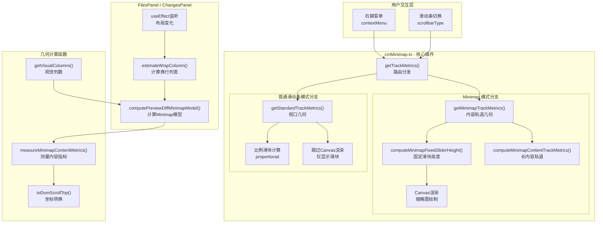

## 1. 高层摘要（TL;DR）

*   **影响范围：** 🔴 **高** - 重构了右侧滚动条的核心架构，分离了 Minimap 和普通滑动条两种模式
*   **关键变更：**
    *   ✅ 彻底分离 Minimap 和普通滑动条的几何计算与渲染逻辑
    *   ✅ 移除普通模式下的"滑块：按比例/固定"菜单选项，强制使用比例滑块
    *   ✅ 新增自动换行（word wrap）支持，动态计算列宽
    *   ✅ 优化普通滑动条视觉样式，使其更现代化
    *   ✅ 添加原生滚动条隐藏支持，确保应用自绘滚动条的一致性

---

## 2. 可视化概览（代码与逻辑映射）



**关键流程说明：**

| 流程 | 描述 | 涉及文件 |
|------|------|----------|
| **模式路由** | `getTrackMetrics()` 根据 `scrollbarType` 路由到不同几何计算分支 | `cmMinimap.ts` |
| **Minimap 渲染** | 使用固定滑块 + 内容轨道 + Canvas 绘制缩略图 | `cmMinimap.ts` |
| **普通滑动条** | 使用比例滑块 + 视口几何，跳过 Canvas 渲染 | `cmMinimap.ts` |
| **换行支持** | 监听布局变化，动态计算 `wrapColumn` 并更新 Minimap 模型 | `ChangesPanel.tsx`, `FilesPanel.tsx` |

---

## 3. 详细变更分析

### 📦 组件 1：核心 Minimap 插件重构

**文件：** `ai-digital-life/frontend/src/app/regions/right-panel/cmMinimap.ts`

#### 🔧 逻辑变更：

1.  **设置模型解耦**
    *   从 `MinimapSettings` 中移除运行时依赖的 `sliderBehavior` 字段
    *   保留类型兼容性，允许读取旧存储但不影响新行为
    *   普通模式强制使用比例滑块，Minimap 模式使用固定滑块

2.  **几何计算分离**
    *   新增 `measureMinimapContentMetrics()`：独立测量内容滚动几何
    *   新增 `toDomScrollTop()`：将内容空间坐标转换回 DOM 滚动位置
    *   新增 `computeMinimapFixedSliderHeight()`：计算随缩放变化的固定滑块高度
    *   新增 `computeMinimapContentTrackMetrics()`：计算 Minimap 内容轨道高度和偏移
    *   新增 `getStandardTrackMetrics()`：普通滑动条专用几何计算
    *   新增 `getMinimapTrackMetrics()`：Minimap 专用几何计算
    *   重构 `getTrackMetrics()`：根据模式路由到不同分支

3.  **Word Wrap 支持**
    *   新增 `getVisualColumns()`：计算每行在换行后的视觉列数
    *   新增 `estimateWrapColumn()`：估算编辑器的换行列宽
    *   修改 `getEffectiveLineCount()`：考虑换行后的实际行数
    *   修改 `getDocumentLineColumns()`：获取文档所有行的视觉列数

4.  **渲染优化**
    *   在 `render()` 中添加普通模式早期返回，跳过 Canvas 渲染
    *   添加 `getContentInsets()`：获取内容区域的 padding
    *   添加 `getContentMetrics()`：获取内容滚动指标
    *   添加 `getContentElement()`：获取内容 DOM 元素
    *   在 `update()` 中监听 `tr.reconfigured` 事件，确保配置变更立即刷新

#### 📊 数据结构变更：

| 类型 | 用途 | 新增/修改 |
|------|------|-----------|
| `MinimapContentMetricsInput` | 内容指标输入参数 | ✅ 新增 |
| `MinimapContentMetrics` | 内容指标返回值 | ✅ 新增 |
| `MinimapContentTrackMetricsInput` | 内容轨道指标输入 | ✅ 新增 |
| `MinimapContentTrackMetrics` | 内容轨道指标返回 | ✅ 新增 |
| `MinimapTrackMetrics` | 轨道指标（内部使用） | ✅ 新增 |
| `MinimapSliderMetricsInput` | 滑块指标输入 | 🔄 修改（添加 contentInsets） |
| `MinimapDragInput` | 拖拽输入参数 | 🔄 修改（使用 contentScrollHeight） |

---

### 🎨 组件 2：样式优化

**文件：** `ai-digital-life/frontend/src/styles/regions.css`

#### 🔧 样式变更：

1.  **普通滑动条现代化**
    *   调整滑块左右边距：`left: 2px; right: 2px;`（原为 3px）
    *   降低滑块默认透明度：`42%`（原为 54%）
    *   调整 hover 状态：`60%`（原为 68%）
    *   调整 active 状态：`72%`（原为 78%）
    *   添加过渡动画：`transition: background 0.15s ease, opacity 0.15s ease`
    *   添加内阴影：`box-shadow: inset 1px 0 0 color-mix(...)`

2.  **原生滚动条隐藏**
    *   为并排 Diff 添加原生滚动条隐藏规则
    *   使用 `scrollbar-width: none` 和 `::-webkit-scrollbar { width: 0; height: 0; }`

---

### 📝 组件 3：面板组件更新

#### FilesPanel.tsx

**文件：** `ai-digital-life/frontend/src/app/regions/right-panel/FilesPanel.tsx`

**变更内容：**
*   导入 `estimateWrapColumn` 函数
*   新增状态：`fileDiffWrapColumn`
*   在 `computePreviewDiffMinimapModel` 调用中传入 `wrapColumn: fileDiffWrapColumn`
*   新增 `useEffect` 监听编辑器布局变化，动态更新 `fileDiffWrapColumn`
    *   监听 `onDidLayoutChange` 事件
    *   监听 `window.resize` 事件
    *   使用 `requestAnimationFrame` 优化性能

#### ChangesPanel.tsx

**文件：** `ai-digital-life/frontend/src/app/regions/right-panel/ChangesPanel.tsx`

**变更内容：**
*   导入 `estimateWrapColumn` 函数
*   新增状态：`changePreviewWrapColumn`
*   在 `computePreviewDiffMinimapModel` 调用中传入 `wrapColumn: changePreviewWrapColumn`
*   新增 `useEffect` 监听编辑器布局变化，动态更新 `changePreviewWrapColumn`
    *   监听 `onDidLayoutChange` 事件
    *   监听 `window.resize` 事件
    *   使用 `requestAnimationFrame` 优化性能

#### DiffViewer.tsx

**文件：** `ai-digital-life/frontend/src/app/regions/right-panel/DiffViewer.tsx`

**变更内容：**
*   在并排 Diff 的 `useEffect` 中添加 `mv.a.requestMeasure()` 和 `mv.b.requestMeasure()`
*   在内联 Diff 的 `useEffect` 中添加 `view.requestMeasure()`
*   确保配置变更后立即触发重新测量

---

### 🔧 组件 4：编辑器适配器扩展

**文件：** `ai-digital-life/frontend/src/app/regions/right-panel/editorAdapters.ts`

**变更内容：**
*   在 `CodeMirrorEditorRef.onDidLayoutChange()` 中添加对 `scrollDOM` 和 `contentDOM` 的观察
*   确保编辑器滚动区域和内容区域的大小变化能被正确监听

---

### 📚 组件 5：文档更新

#### 用户操作手册

**文件：**
*   `UIOperationManual/rightpanel/tools/changes.md`
*   `UIOperationManual/rightpanel/tools/files.md`

**更新内容：**
*   更新"滑动条：普通"描述，强调使用现代化比例滑块
*   更新"缩放"描述，说明其同时联动固定滑块尺寸
*   新增说明段落：
    *   Minimap 模式下滑块固定显示在与正文真实可视区域对应的内容轨道上
    *   普通模式下滚动条与 minimap 的内容轨道算法完全分离
    *   中短文件保持自然缩放显示，不会被强制拉伸填满整个外框

#### 设计文档

**文件：**
*   `ai-digital-life/docs/design-system/testing.md`
*   `ai-digital-life/docs/editor-comparison.md`

**更新内容：**
*   更新测试范围描述，新增"固定滑块缩放行为"和"自然与长内容轨道切换"
*   更新编辑器对比说明，明确两种模式的几何和样式语义已拆分

#### 新增文档

**文件：**
*   `docs/superpowers/plans/2026-05-11-standard-scrollbar-decoupling.md`
*   `docs/superpowers/specs/2026-05-11-standard-scrollbar-decoupling-design.md`

**内容：**
*   详细的实现计划和设计规范
*   架构设计、菜单设计、CSS 视觉结构
*   测试策略和验收标准

---

### 🧪 组件 6：测试更新

#### 新增测试

**文件：** `ai-digital-life/frontend/src/app/regions/right-panel/editorAdapters.test.ts`

**测试内容：**
*   验证编辑器适配器正确观察 DOM、scrollDOM 和 contentDOM

#### 更新测试

**文件：** `ai-digital-life/frontend/src/app/regions/right-panel/cmMinimap.test.ts`

**新增测试用例：**
*   测试内容滚动几何独立于编辑器呼吸空间
*   测试滑块尺寸和位置映射到可读内容区域
*   测试内容空间拖拽目标转换回 DOM 滚动位置
*   测试顶部拖拽位置固定在 DOM 顶部
*   测试固定 Minimap 滑块高度随缩放缩放
*   测试长文件扩展 Minimap 内容轨道
*   测试短文件保持在视口内
*   测试缩放让 Minimap 内容轨道增长
*   测试中等文件保持自然 Minimap 高度
*   测试内容未填满视口时使用可见 Minimap 内容高度作为滑块轨道
*   测试普通模式不再显示"滑块：按比例/固定"菜单
*   测试使用固定 Minimap 滑块
*   测试在编辑器重新配置和内容几何变化时重新渲染
*   测试普通滑动条几何与 Minimap 内容轨道几何分离
*   测试普通轨道宽度独立于之前的 Minimap 宽度
*   测试应用自有的普通轨道激活时继续隐藏原生滚动条

**文件：** `ai-digital-life/frontend/src/app/regions/right-panel/cmPreviewStyling.test.ts`

**新增断言：**
*   验证并排 Diff 的原生滚动条隐藏规则

**文件：** `ai-digital-life/frontend/src/app/regions/right-panel/filesEditorOptions.test.ts`

**新增测试用例：**
*   测试从活动编辑器布局重新计算文件 diff minimap 换行

**文件：** `ai-digital-life/frontend/src/app/regions/right-panel/changesEditorOptions.test.ts`

**新增测试用例：**
*   测试从修改后的编辑器布局重新计算变更预览 minimap 换行

---

## 4. 影响与风险评估

### ⚠️ 破坏性变更

| 变更类型 | 影响范围 | 说明 |
|----------|----------|------|
| **菜单项移除** | 用户界面 | 普通模式下不再显示"滑块：按比例/固定"选项 |
| **行为变更** | 滚动条交互 | 普通滑动条强制使用比例滑块，不再支持固定滑块模式 |
| **几何计算** | Minimap 显示 | Minimap 模式现在考虑 word wrap，换行文件的高度计算会变化 |

### ✅ 向后兼容性

*   ✅ 保留对旧 `sliderBehavior` 存储值的读取兼容性
*   ✅ 不改变文件/变更视图的 scope 持久化机制
*   ✅ 不引入新的后端 IPC 或配置文件

### 🧪 测试建议

#### 必测场景：

1.  **模式切换测试**
    *   在 Files 和 Changes 视图中切换 Minimap/普通模式
    *   验证切换后菜单内容正确
    *   验证切换后滚动条行为正确

2.  **Word Wrap 测试**
    *   启用 word wrap 后验证 Minimap 高度正确更新
    *   调整窗口大小验证换行重新计算
    *   验证并排 Diff 和内联 Diff 都能正确处理换行

3.  **长文件测试**
    *   打开长文件验证 Minimap 内容轨道正确扩展
    *   验证滑块拖拽定位准确
    *   验证短文件保持在自然高度

4.  **普通滑动条测试**
    *   验证普通滑动条使用比例滑块
    *   验证 hover/active 状态视觉正确
    *   验证原生滚动条被隐藏

5.  **兼容性测试**
    *   验证旧设置值不会导致异常
    *   验证全局/独立设置切换正常
    *   验证浏览器模式和 Tauri 模式一致

#### 边缘情况：

*   空文件的滚动条显示
*   单行超长文件的换行处理
*   快速切换模式时的性能
*   同时打开多个文件时的设置隔离

---

## 5. 关键代码片段

### Word Wrap 列估算

```typescript
// cmMinimap.ts
export function estimateWrapColumn(view: EditorView): number | null {
  if (!view.lineWrapping) return null;
  const charWidth = view.defaultCharacterWidth;
  const contentWidth = view.contentDOM.clientWidth;
  if (!Number.isFinite(charWidth) || charWidth <= 0 || contentWidth <= 0) return null;
  return Math.max(1, Math.floor(contentWidth / charWidth));
}
```

### 模式路由

```typescript
// cmMinimap.ts
private getTrackMetrics(scrollElement: HTMLElement = this.scrollElement): MinimapTrackMetrics {
  return this.settings.scrollbarType === "standard"
    ? this.getStandardTrackMetrics(scrollElement)
    : this.getMinimapTrackMetrics(scrollElement);
}
```

### 内容轨道计算

```typescript
// cmMinimap.ts
export function computeMinimapContentTrackMetrics(input: MinimapContentTrackMetricsInput): MinimapContentTrackMetrics {
  const viewportHeight = Math.max(1, input.viewportHeight);
  const fixedSliderHeight = clamp(input.fixedSliderHeight, Math.min(1, viewportHeight), viewportHeight);
  const contentScrollHeight = Math.max(0, input.contentScrollHeight);
  const contentViewportHeight = Math.max(0, input.contentViewportHeight);
  const contentScrollTop = Math.max(0, input.contentScrollTop);
  const naturalContentHeight = Math.max(1, input.naturalContentHeight);
  const maxContentScrollTop = Math.max(0, contentScrollHeight - contentViewportHeight);

  if (naturalContentHeight <= viewportHeight) {
    return {
      contentHeight: naturalContentHeight,
      contentOffset: 0,
    };
  }

  if (maxContentScrollTop <= 0 || contentViewportHeight <= 0) {
    return {
      contentHeight: clamp(naturalContentHeight, 1, viewportHeight),
      contentOffset: 0,
    };
  }

  const derivedContentHeight = Math.max(
    viewportHeight,
    Math.round((fixedSliderHeight * contentScrollHeight) / contentViewportHeight),
  );
  const contentHeight = Math.max(derivedContentHeight, naturalContentHeight);
  const maxContentOffset = Math.max(0, contentHeight - viewportHeight);
  const ratio = maxContentScrollTop <= 0 ? 0 : clamp(contentScrollTop, 0, maxContentScrollTop) / maxContentScrollTop;
  return {
    contentHeight,
    contentOffset: Math.round(maxContentOffset * ratio),
  };
}
```

---

## 6. 总结

本次重构实现了 Minimap 和普通滑动条的彻底解耦，主要成果包括：

1.  **架构清晰**：两种模式在几何计算、渲染逻辑和菜单选项上完全分离
2.  **功能增强**：新增 word wrap 支持，自动计算换行列宽
3.  **体验优化**：普通滑动条采用现代化设计，视觉更清爽
4.  **维护性提升**：修改任一模式不会影响另一模式，降低维护成本
5.  **文档完善**：新增详细的实现计划和设计规范文档

这是一次高质量的重构，在保持向后兼容的同时，显著提升了代码的可维护性和用户体验。