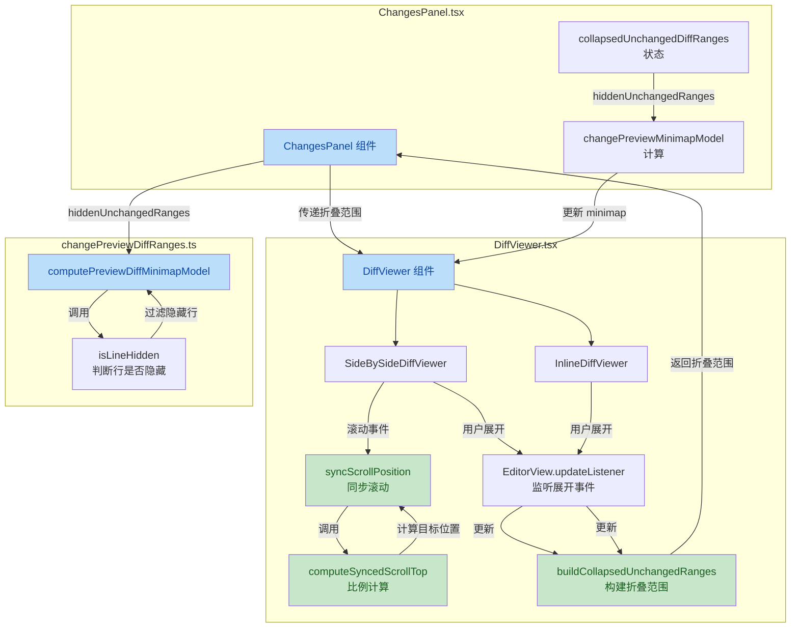

## 1. 高层摘要 (TL;DR)

**影响范围：** 🟡 **中等** - 重构了差异查看器的滚动同步和折叠逻辑，提升用户体验

**核心变更：**
- ✅ **改进滚动同步算法**：从直接赋值改为比例计算，解决两侧面板高度不一致时的滚动错位问题
- ✅ **动态折叠范围管理**：追踪用户手动展开的行，智能更新折叠状态
- ✅ **Minimap 优化**：minimap 现在正确排除折叠的未变更行，提供准确的视觉反馈
- ✅ **新增滚动事件处理**：在容器级别统一处理垂直滚动，提升交互流畅度

---

## 2. 可视化概览 (代码与逻辑映射)



**业务流程说明：**

1. **折叠范围管理流程：**
   - 用户在 DiffViewer 中手动展开折叠区域 → `EditorView.updateListener` 捕获 `uncollapseUnchanged` 事件
   - 更新 `expandedCollapsedLinesRef` → 调用 `buildCollapsedUnchangedRanges` 重新计算折叠范围
   - 通过 `onCollapsedUnchangedRangesChange` 回调传递给 `ChangesPanel`
   - `ChangesPanel` 更新 `collapsedUnchangedDiffRanges` 状态
   - 重新计算 `changePreviewMinimapModel`，传入 `hiddenUnchangedRanges`

2. **滚动同步流程：**
   - 用户在任一面板滚动 → 触发 `handleScrollA` 或 `handleScrollB`
   - 调用 `syncScrollPosition` → 使用 `computeSyncedScrollTop` 计算目标滚动位置（基于比例）
   - 更新另一侧面板的 `scrollTop`，实现精确同步

---

## 3. 详细变更分析

### 📁 **组件层：ChangesPanel.tsx**

**变更内容：**
- 移除 `minimapExpandedUnchangedDiff` 布尔状态，替换为 `collapsedUnchangedDiffRanges` 数组状态
- 移除 `handleMinimapDragStart` 回调函数
- 更新 `computePreviewDiffMinimapModel` 调用，传入 `hiddenUnchangedRanges` 参数

**关键代码片段：**
```typescript
// 旧状态
const [minimapExpandedUnchangedDiff, setMinimapExpandedUnchangedDiff] = useState(false);

// 新状态
const [collapsedUnchangedDiffRanges, setCollapsedUnchangedDiffRanges] = useState<PreviewDiffCollapsedRange[]>([]);

// 新的 minimap 模型计算
const changePreviewMinimapModel = useMemo(
  () => changePreview
    ? computePreviewDiffMinimapModel(changePreview.baseContent, changePreview.currentContent, {
        hiddenUnchangedRanges: collapseUnchangedDiff ? collapsedUnchangedDiffRanges : [],
      })
    : undefined,
  [changePreview, collapseUnchangedDiff, collapsedUnchangedDiffRanges]
);
```

**影响：**
- 从简单的布尔标志改为精确的范围追踪，支持更细粒度的折叠控制
- minimap 现在能准确反映当前折叠状态

---

### 📁 **核心组件：DiffViewer.tsx**

#### **3.1 新增类型与常量**

| 类型/常量 | 用途 |
|-----------|------|
| `ScrollSyncMetrics` | 定义滚动同步所需的指标（滚动位置、内容高度、可视区域高度） |
| `COLLAPSE_UNCHANGED_CONFIG` | 折叠配置常量：`{ margin: 3, minSize: 4 }` |
| `PreviewDiffCollapsedRange` | 折叠范围类型：`{ startLine: number; endLine: number }` |

#### **3.2 新增核心函数**

**`computeSyncedScrollTop` - 比例滚动计算**
```typescript
export function computeSyncedScrollTop(input: ScrollSyncMetrics): number {
  const sourceMax = Math.max(0, input.sourceScrollHeight - input.sourceClientHeight);
  if (sourceMax <= 0) return 0;
  const targetMax = Math.max(0, input.targetScrollHeight - input.targetClientHeight);
  const ratio = Math.max(0, Math.min(input.sourceScrollTop, sourceMax)) / sourceMax;
  return ratio * targetMax;
}
```
**作用：** 根据源面板的滚动比例计算目标面板的滚动位置，解决高度不一致时的同步问题。

**`buildCollapsedUnchangedRanges` - 构建折叠范围**
```typescript
export function buildCollapsedUnchangedRanges(input: {
  chunks: readonly MergeChunk[];
  doc: EditorState["doc"];
  margin?: number;
  minSize?: number;
  expandedLines?: ReadonlySet<number>;
}): PreviewDiffCollapsedRange[]
```
**作用：** 基于差异块（chunks）和用户展开的行（expandedLines）计算应该折叠的未变更范围。

**`syncScrollPosition` - 同步滚动位置**
```typescript
function syncScrollPosition(source: HTMLElement, target: HTMLElement) {
  const nextScrollTop = computeSyncedScrollTop({
    sourceScrollTop: source.scrollTop,
    sourceScrollHeight: source.scrollHeight,
    sourceClientHeight: source.clientHeight,
    targetScrollHeight: target.scrollHeight,
    targetClientHeight: target.clientHeight,
  });
  if (Math.abs(target.scrollTop - nextScrollTop) > 0.5) {
    target.scrollTop = nextScrollTop;
  }
}
```
**作用：** 执行实际的滚动同步操作，包含阈值判断避免不必要的更新。

#### **3.3 SideBySideDiffViewer 增强**

**变更点：**
1. 新增 `expandedCollapsedLinesRef` 追踪用户手动展开的行
2. 添加 `EditorView.updateListener` 监听 `uncollapseUnchanged` 事件
3. 改进滚动同步逻辑（使用 `syncScrollPosition` 替代直接赋值）
4. 新增 `handleWheel` 事件处理，在容器级别统一处理垂直滚动

**关键代码：**
```typescript
// 监听展开事件
EditorView.updateListener.of((update) => {
  const expandedLines = update.transactions.flatMap((transaction) => transaction.effects)
    .filter((effect) => effect.is(uncollapseUnchanged))
    .map((effect) => update.state.doc.lineAt(effect.value).number);
  if (expandedLines.length > 0) {
    expandedLines.forEach((line) => expandedCollapsedLinesRef.current.add(line));
  }
  if (expandedLines.length > 0 || update.docChanged) {
    emitCollapsedUnchangedRanges(update.view);
  }
})

// 改进的滚动同步
const handleScrollA = () => {
  if (syncing) return;
  syncing = true;
  if (mv.b) {
    syncScrollPosition(mv.a.scrollDOM, mv.b.scrollDOM);
  }
  syncing = false;
};

// 新增 wheel 事件处理
const handleWheel = (event: WheelEvent) => {
  if (event.ctrlKey || event.metaKey || Math.abs(event.deltaY) <= Math.abs(event.deltaX)) {
    return;
  }
  const previousScrollTop = mv.dom.scrollTop;
  mv.dom.scrollTop += event.deltaY;
  if (Math.abs(mv.dom.scrollTop - previousScrollTop) > 0.5) {
    handleScrollB();
    event.preventDefault();
  }
};
```

#### **3.4 InlineDiffViewer 增强**

**变更点：**
- 同样新增 `expandedCollapsedLinesRef` 和 `EditorView.updateListener`
- 在组件初始化时立即计算并上报初始折叠范围

---

### 📁 **工具层：changePreviewDiffRanges.ts**

**变更内容：**
1. 新增 `PreviewDiffCollapsedRange` 类型定义
2. 在 `PreviewDiffMinimapOptions` 中添加 `hiddenUnchangedRanges` 选项
3. 新增 `isLineHidden` 辅助函数
4. 修改 `computePreviewDiffMinimapModel`，在计算 minimap 时跳过隐藏的未变更行

**关键代码：**
```typescript
export type PreviewDiffCollapsedRange = {
  startLine: number;
  endLine: number;
};

function isLineHidden(lineNumber: number, hiddenUnchangedRanges: PreviewDiffCollapsedRange[]): boolean {
  return hiddenUnchangedRanges.some((range) => lineNumber >= range.startLine && lineNumber <= range.endLine);
}

// 在计算 minimap 时过滤隐藏行
while (i < baseLines.length || j < currentLines.length) {
  if (i < baseLines.length && j < currentLines.length && baseLines[i] === currentLines[j]) {
    const currentLineNumber = j + 1;
    if (!isLineHidden(currentLineNumber, hiddenUnchangedRanges)) {
      const columns = getVisualColumns(currentLines[j], wrapColumn);
      lineColumns.push(...columns);
      visualLine += columns.length;
    }
    i += 1;
    j += 1;
    continue;
  }
  // ... 处理差异行
}
```

---

### 📁 **测试文件**

#### **DiffViewer.test.ts (新增)**

| 测试用例 | 验证内容 |
|---------|---------|
| `preserves scroll position by ratio` | 比例滚动计算正确性 |
| `keeps the target at the top when the source cannot scroll` | 不可滚动时的边界情况 |
| `builds collapsed unchanged ranges with merge-view margins applied` | 折叠范围计算包含 margin |
| `drops a collapsed range after the user expands it` | 用户展开后正确移除折叠范围 |

#### **changePreviewDiffRanges.test.ts (新增测试)**

| 测试用例 | 验证内容 |
|---------|---------|
| `omits folded unchanged lines from the minimap model` | minimap 正确排除折叠的未变更行 |

---

## 4. 影响与风险评估

### ⚠️ **破坏性变更**

| 变更项 | 旧 API | 新 API | 影响 |
|--------|--------|--------|------|
| DiffViewer Props | `onMinimapDragStart?: () => void` | `onCollapsedUnchangedRangesChange?: (ranges: PreviewDiffCollapsedRange[]) => void` | **破坏性** - 需要更新调用方 |
| ChangesPanel State | `minimapExpandedUnchangedDiff: boolean` | `collapsedUnchangedDiffRanges: PreviewDiffCollapsedRange[]` | 内部状态变更，对外部透明 |

### ✅ **测试建议**

1. **滚动同步测试：**
   - 验证两侧面板高度不一致时的滚动同步准确性
   - 测试快速滚动时的性能表现
   - 验证 wheel 事件在容器级别的处理是否正常

2. **折叠功能测试：**
   - 测试手动展开折叠区域后，minimap 是否正确更新
   - 验证切换文件时折叠状态是否正确重置
   - 测试多个折叠区域同时存在时的行为

3. **边界情况测试：**
   - 空文件或单行文件的滚动行为
   - 全部内容折叠或全部展开时的行为
   - 非常大的文件（数千行）的性能表现

4. **回归测试：**
   - 验证现有的 diff 查看功能不受影响
   - 确认 minimap 的其他功能（如点击跳转）仍然正常

### 🎯 **性能考虑**

- ✅ **优化点：** minimap 计算时跳过隐藏行，减少渲染负担
- ✅ **优化点：** 滚动同步使用阈值判断（`> 0.5`），避免不必要的 DOM 操作
- ⚠️ **注意：** 每次用户展开行都会重新计算折叠范围，对于频繁操作可能需要考虑防抖

---

## 5. 总结

这次重构显著提升了差异查看器的用户体验：

1. **更精确的滚动同步** - 通过比例计算解决了高度不一致导致的滚动错位问题
2. **智能折叠管理** - 系统能记住用户手动展开的行，提供更自然的交互体验
3. **准确的视觉反馈** - minimap 现在正确反映折叠状态，帮助用户快速定位变更
4. **更好的代码组织** - 将滚动同步和折叠逻辑封装为独立函数，提高可测试性

整体而言，这是一次高质量的重构，在保持向后兼容的同时（除了内部状态变更），显著提升了组件的功能性和可维护性。