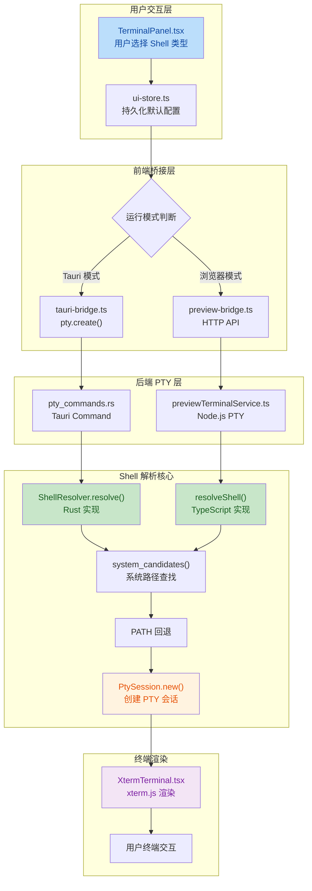

## 1. 高层摘要（TL;DR）

**影响范围**：中等 - 重构终端 Shell 解析机制，清理已完成的设计文档

**核心变更**：
- 🎯 **终端 Shell 解析重构**：实现统一的 Shell 解析器，支持 PowerShell/CMD/Bash，提供两级查找和详细错误恢复指引
- 🔧 **浏览器模式 PTY 升级**：从 `child_process.spawn` 升级到 `node-pty`，提供真正的 PTY 支持
- 📝 **文档清理**：删除 8 个已完成的设计文档和 3 个规格文档
- ✨ **UI 改进**：优化终端空状态显示，添加默认 Shell 配置持久化

---

## 2. 可视化概览（代码与逻辑映射）



---

## 3. 详细变更分析

### 3.1 终端 Shell 解析重构（核心功能）

#### 📁 新增文件

| 文件 | 说明 |
|------|------|
| `crates/terminal/src/shell_resolver.rs` | Rust 端 Shell 解析器实现 |
| `ai-digital-life/docs/superpowers/plans/2026-05-20-terminal-shell-resolution.md` | Shell 解析实现计划文档 |

#### 🔧 Rust 端实现（Tauri 模式）

**文件：`crates/terminal/src/shell_resolver.rs`**

新增统一的 Shell 解析器，实现两级查找机制：

```rust
pub enum ShellKind {
    PowerShell,
    Cmd,
    Bash,
}

pub struct ShellResolution {
    pub kind: ShellKind,
    pub program: String,
    pub args: Vec<String>,
}
```

**查找策略**：
1. **Level 1**：系统已知路径（如 `C:\Windows\System32\WindowsPowerShell\v1.0\powershell.exe`）
2. **Level 2**：PATH 环境变量回退
3. **错误处理**：提供详细的恢复指引

**系统路径候选**：

| Shell | 候选路径 |
|-------|---------|
| PowerShell | `System32\WindowsPowerShell\v1.0\powershell.exe`<br/>`SysWOW64\WindowsPowerShell\v1.0\powershell.exe` |
| CMD | `System32\cmd.exe`<br/>`%COMSPEC%` |
| Bash | `Program Files\Git\bin\bash.exe`<br/>`Program Files (x86)\Git\bin\bash.exe`<br/>`System32\wsl.exe` |

**文件：`crates/terminal/src/pty.rs`**

重构 PTY 会话创建逻辑：

```rust
pub struct PtyConfig {
    pub program: String,
    pub args: Vec<String>,
}

impl PtySession {
    pub fn new(
        config: PtyConfig,
        cwd: &str,
        cols: u16,
        rows: u16,
    ) -> Result<Self, AppError> { ... }
}
```

**关键改进**：
- 解耦路径解析与 PTY 创建
- 旧 `create()` 方法标记为 `#[deprecated]`
- 支持预解析的 Shell 配置

**文件：`crates/terminal/src/session_manager.rs`**

集成 ShellResolver：

```rust
pub fn create(
    &self,
    app: tauri::AppHandle,
    shell: &str,
    cwd: &str,
    cols: u16,
    rows: u16,
) -> Result<String, AppError> {
    let resolution = ShellResolver::resolve(shell)
        .map_err(|e| AppError::Terminal(format!(
            "{} not found.\n\nRecovery:\n{}",
            e.kind.display_name(),
            e.kind.recovery_guide(),
        )))?;
    
    let config = PtyConfig {
        program: resolution.program,
        args: resolution.args,
    };
    let session = PtySession::new(config, cwd, cols, rows)?;
    // ...
}
```

#### 🔧 Node.js 端实现（浏览器模式）

**文件：`frontend/dev/previewTerminalService.ts`**

**重大变更**：从 `child_process.spawn` 升级到 `node-pty`

| 变更项 | 旧实现 | 新实现 |
|--------|--------|--------|
| PTY 库 | `child_process.spawn` | `node-pty` |
| Shell 解析 | 简单字符串映射 | 统一解析器（与 Rust 端逻辑一致） |
| 输出处理 | `stdout/stderr` 事件 | `onData` 回调 |
| 调整大小 | 不支持 | `resize(cols, rows)` |

**新增依赖**：
```json
{
  "dependencies": {
    "node-pty": "^1.1.0"
  }
}
```

**Shell 解析逻辑**：

```typescript
type ShellKind = "powershell" | "cmd" | "bash";

interface ShellResolution {
  program: string;
  args: string[];
}

function systemCandidates(kind: ShellKind): string[] {
  // 与 Rust 端相同的候选路径
}

function resolveShell(shell: string): { resolution: ShellResolution } | { error: string } {
  // 两级查找：系统路径 → PATH
}
```

**PTY 创建**：

```typescript
const { resolution } = resolved;
let ptyProcess: pty.IPty;
try {
  ptyProcess = pty.spawn(resolution.program, resolution.args, {
    name: "xterm-256color",
    cols: body?.cols || 80,
    rows: body?.rows || 24,
    cwd,
    env: { ...process.env, TERM: "xterm-256color" },
  });
} catch (err: unknown) {
  // 错误处理
}
```

#### 🎨 前端 UI 改进

**文件：`frontend/src/app/regions/right-panel/TerminalPanel.tsx`**

**新增功能**：
1. **默认 Shell 配置持久化**
   ```typescript
   const defaultTerminalProfile = useUiStore((state) => state.defaultTerminalProfile);
   const setDefaultTerminalProfile = useUiStore((state) => state.setDefaultTerminalProfile);
   ```

2. **空状态优化**
   ```tsx
   <div className="adl-terminal-empty">
     <div className="adl-terminal-empty__card">
       <div className="adl-terminal-empty__header">
         <IconTerminal size={16} decorative />
         <span>终端面板</span>
       </div>
       <p className="adl-terminal-empty__text">
         当前没有打开的终端会话<br />
         选择一个 Shell 类型开始：
       </p>
       <div className="adl-terminal-empty__items">
         {shellTypeItems.map((item) => (
           <button key={item.id} onClick={() => handleCreateTab(item.profile)}>
             <ShellPrefix profile={item.profile} />
             <span>{item.label}</span>
           </button>
         ))}
       </div>
     </div>
   </div>
   ```

3. **Shell 启动失败提示**
   ```tsx
   {activeTab.status === "terminated" && !activeTab.sessionId && (
     <div className="adl-terminal-error-note">
       <span>⚠</span>
       <span>{t.terminalShellNotFound}</span>
     </div>
   )}
   ```

**文件：`frontend/src/app/components/terminal/XtermTerminal.tsx`**

**新增 resize 回调**：

```typescript
export interface XtermTerminalProps {
  className?: string;
  onData?: (data: string) => void;
  onResize?: (cols: number, rows: number) => void;  // 新增
}

const resizeObserver = new ResizeObserver(() => {
  const addon = fitAddonRef.current;
  addon?.fit();
  const term = terminalRef.current;
  if (addon && term) {
    const dims = addon.proposeDimensions();
    if (dims) {
      onResizeRef.current?.(dims.cols, dims.rows);  // 通知后端调整 PTY 大小
    }
  }
});
```

**文件：`frontend/src/app/ui-store.ts`**

**新增状态管理**：

```typescript
const TERMINAL_DEFAULT_PROFILE_KEY = "adl-ui:terminal-default-profile";

export interface UiState {
  defaultTerminalProfile: TerminalProfile;  // 新增
  setDefaultTerminalProfile: (profile: TerminalProfile) => void;  // 新增
}

// 初始化
defaultTerminalProfile: readJson<TerminalProfile>(TERMINAL_DEFAULT_PROFILE_KEY, "powershell"),

// Action
setDefaultTerminalProfile: (profile) => {
  writeJson(TERMINAL_DEFAULT_PROFILE_KEY, profile);
  set({ defaultTerminalProfile: profile });
}
```

**文件：`frontend/src/styles/regions.css`**

**新增样式**：

```css
.adl-terminal-empty {
  display: flex;
  align-items: center;
  justify-content: center;
  height: 100%;
  background: var(--bg);
}

.adl-terminal-empty__card {
  display: flex;
  flex-direction: column;
  align-items: center;
  gap: var(--space-3);
  padding: 28px 24px;
  border: 1px solid var(--border);
  border-radius: var(--radius-lg);
  max-width: 380px;
}

.adl-terminal-empty__item {
  display: inline-flex;
  align-items: center;
  gap: 5px;
  padding: 5px 10px;
  border-radius: var(--radius-sm);
  font-size: var(--font-sm);
  cursor: pointer;
  border: 1px solid transparent;
  color: var(--text-secondary);
  transition: background-color var(--duration-150) var(--ease-default),
              border-color var(--duration-150) var(--ease-default);
  background: transparent;
}

.adl-terminal-empty__item:hover {
  border-color: var(--border);
  background: var(--bg-muted);
}

.adl-terminal-error-note {
  display: flex;
  align-items: center;
  gap: 6px;
  padding: 6px 12px;
  background: var(--bg-warning, #2d1f00);
  color: var(--text-warning, #ffa726);
  font-size: 12px;
  border-top: 1px solid var(--border-warning, #5a3e00);
}
```

**文件：`frontend/src/app/copy.ts`**

**新增文案**：

| Key | 中文 | 英文 |
|-----|------|------|
| `terminalShellNotFound` | "未找到终端程序，请在终端输出中查看恢复指引。" | "Shell not found. Check terminal output for recovery instructions." |

#### 🔧 依赖更新

| 文件 | 变更 |
|------|------|
| `ai-digital-life/Cargo.toml` | 新增 `dirs = "5"` |
| `ai-digital-life/crates/terminal/Cargo.toml` | 新增 `dirs.workspace = true` |
| `ai-digital-life/frontend/package.json` | 新增 `"node-pty": "^1.1.0"` |

#### 🔧 Tauri Command 改进

**文件：`src-tauri/src/commands/pty_commands.rs`**

**CWD 处理改进**：

```rust
pub async fn pty_create(
    state: State<'_, AppState>,
    input: PtyCreateInput,
) -> Result<IpcResult<PtyCreateResult>, CommandError> {
    let cwd = match input.cwd {
        Some(c) => c,
        None => match crate::commands::workspace::current_workspace(&state) {
            Ok(w) => w.root_path,
            Err(_) => std::env::current_dir()
                .unwrap_or_else(|_| PathBuf::from("."))
                .to_string_lossy()
                .to_string(),
        },
    };
    // ...
}
```

**改进点**：
- 当没有工作区时，回退到当前目录
- 避免因无工作区导致 PTY 创建失败

### 3.2 文档清理

#### 🗑️ 删除的设计文档（`.trae/documents/`）

| 文件 | 说明 |
|------|------|
| `diff-background-jumping-fix-plan.md` | 变更背景跳动修复计划 |
| `fold-tooltip-fix-plan.md` | 折叠图标 Tooltip 修复计划 |
| `minimap-diff-fixes-plan.md` | Minimap 与变更功能修复计划 |
| `side-by-side-divider-gradient-design.md` | 并排 Diff 分隔区域分层设计方案 |
| `tooltip-redesign-plan.md` | Tooltip 组件优化计划 |
| `workspace-menu-split-button-design.md` | 工作区菜单复合按钮设计文档 |
| `workspace-menu-split-button-plan.md` | 工作区菜单复合按钮实现计划 |
| `workspace-selection-redesign-plan.md` | 工作区选择/路径绑定重构方案 |

#### 🗑️ 删除的规格文档（`.trae/specs/`）

| 目录 | 文件 | 说明 |
|------|------|------|
| `remove-minimap-slider/` | `checklist.md`, `spec.md`, `tasks.md` | 删除 Minimap 滑动条相关规格 |
| `terminal-pty-redesign/` | `checklist.md`, `spec.md`, `tasks.md` | 终端 PTY 重设计相关规格 |

**删除原因**：这些功能已经实现完成，规格文档不再需要保留。

### 3.3 文档更新

#### 📝 AGENTS.md 更新

**文件：`ai-digital-life/AGENTS.md`**

```markdown
- xterm.js 交互式终端（多会话 PTY）
+ xterm.js 交互式终端（多会话 PTY，支持 CMD / PowerShell / Bash）
+   - Tauri 桌面模式：Rust `portable-pty`（ConPTY）
+   - 浏览器预览模式：`node-pty`（ConPTY/WinPTY），替代之前 `child_process.spawn` 的编码 hack
```

**更新内容**：
- 明确列出支持的 Shell 类型
- 说明双端 PTY 实现差异

---

## 4. 影响与风险评估

### ✅ 破坏性变更

| 变更 | 影响 | 缓解措施 |
|------|------|----------|
| 浏览器模式 PTY 从 `child_process.spawn` 升级到 `node-pty` | 需要安装 `node-pty` 依赖 | 已在 `package.json` 中添加依赖 |
| Rust 端 `PtySession::create()` 标记为 deprecated | 旧代码可能仍调用该方法 | 保留该方法作为过渡期兼容层 |

### ⚠️ 风险点

| 风险 | 概率 | 影响 | 缓解措施 |
|------|------|------|----------|
| `node-pty` 在某些环境下编译失败 | 低 | 高 | 该包在 Windows 上有预编译二进制，通常无需编译 |
| Shell 路径解析在不同 Windows 版本上不一致 | 低 | 中 | 两级查找机制（系统路径 → PATH）提供回退 |
| 终端会话状态持久化清理导致用户数据丢失 | 低 | 低 | 清理的是 localStorage 中的旧数据，不影响当前会话 |

### 🧪 测试建议

1. **Shell 解析测试**
   - [ ] 验证 PowerShell/CMD/Bash 在不同 Windows 版本上都能正确解析
   - [ ] 测试 PATH 回退机制（当系统路径不存在时）
   - [ ] 验证错误恢复指引显示正确

2. **PTY 功能测试**
   - [ ] 浏览器模式下 PTY 创建、输入、输出、调整大小
   - [ ] Tauri 模式下 PTY 创建、输入、输出、调整大小
   - [ ] 多会话切换和隔离

3. **UI 测试**
   - [ ] 空状态显示正确
   - [ ] Shell 启动失败时错误提示显示
   - [ ] 默认 Shell 配置持久化

4. **兼容性测试**
   - [ ] 旧版本终端会话清理逻辑
   - [ ] localStorage 清理不影响新会话

---

## 5. 总结

本次变更主要完成了终端 Shell 解析机制的重构，实现了以下目标：

✅ **统一解析逻辑**：Rust 端和 Node.js 端使用相同的两级查找策略  
✅ **真正的 PTY 支持**：浏览器模式从 `child_process.spawn` 升级到 `node-pty`  
✅ **用户体验改进**：优化空状态显示，添加错误恢复指引  
✅ **配置持久化**：默认 Shell 配置保存到 localStorage  
✅ **文档清理**：删除已完成的设计和规格文档

这些改进为终端功能提供了更稳定、更可靠的 Shell 解析能力，同时为用户提供了更好的错误处理和恢复指引。