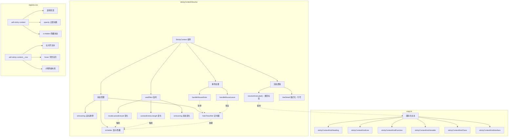

## 1. 高层摘要 (TL;DR)

*   **影响:** 🟡 **中等** - 重构了编辑器 Sticky Context 组件的交互逻辑和视觉设计
*   **关键变更:**
    *   ✨ 新增自动隐藏功能：1.5秒无操作后自动隐藏，鼠标悬停时暂停
    *   🎨 视觉设计重构：完全透明背景、右对齐文本、移除边框和阴影
    *   🌐 国际化支持：添加了 6 种上下文类型的中英文标签
    *   📝 文档更新：统一引号格式，更新设计规则说明

---

## 2. 可视化概览 (代码与逻辑图)



---

## 3. 详细变更分析

### 🎨 组件重构：Sticky Context 交互与视觉

**文件:** `ai-digital-life/frontend/src/app/regions/right-panel/stickyContextView.tsx`

**变更内容:**

#### 1. 新增自动隐藏逻辑
- **自动隐藏定时器:** 1.5秒无操作后自动隐藏 Sticky Context
- **鼠标悬停暂停:** 鼠标悬停时暂停隐藏计时器，离开后恢复
- **状态管理:** 新增 `isVisible`、`isHovering`、`hideTimerRef` 状态

#### 2. 国际化支持
- **新增 `resolveKindLabel()` 函数:** 将代码类型映射为本地化标签
- **行号格式化:** 从 `L123` 格式改为 `行 123`（中文）/ `Line 123`（英文）
- **类型标签支持:** 标题、行、函数、变量、类、接口

#### 3. 视觉布局调整
- **移除 `is-active` 类:** 不再高亮当前活动条目
- **图标位置调整:** "回到顶部"箭头图标内联显示在标签前
- **简化布局:** 移除独立的 kind 列，图标与标签合并

---

### 🎨 样式重构：透明设计与动画

**文件:** `ai-digital-life/frontend/src/styles/regions.css`

**变更内容:**

| 属性 | 旧值 | 新值 | 说明 |
|------|------|------|------|
| `background` | `var(--surface)` | `transparent` | 完全透明背景 |
| `border` | `1px solid var(--border-subtle)` | `none` | 移除边框 |
| `text-align` | `left` | `right` | 右对齐文本 |
| `grid-template-columns` | `3px 18px minmax(0, 1fr)` | `3px minmax(0, 1fr)` | 从3列简化为2列 |
| `box-shadow` | `inset 0 0 0 1px ...` | 无 | 移除边框阴影 |

**新增动画效果:**
```css
.adl-sticky-context {
  opacity: 1;
  transition: opacity 0.2s ease-out, visibility 0s linear 0.2s;
}

.adl-sticky-context.is-hidden {
  opacity: 0;
  pointer-events: none;
  visibility: hidden;
}
```

---

### 🌐 国际化文本扩展

**文件:** `ai-digital-life/frontend/src/app/copy.ts`

**新增翻译键值:**

| 键名 | 中文 | 英文 |
|------|------|------|
| `stickyContextKindHeading` | 标题 | Heading |
| `stickyContextKindLine` | 行 | Line |
| `stickyContextKindFunction` | 函数 | Function |
| `stickyContextKindVariable` | 变量 | Variable |
| `stickyContextKindClass` | 类 | Class |
| `stickyContextKindInterface` | 接口 | Interface |

---

### 🔧 组件集成更新

**文件:** 
- `ai-digital-life/frontend/src/app/regions/right-panel/ChangesPanel.tsx`
- `ai-digital-life/frontend/src/app/regions/right-panel/FilesPanel.tsx`

**变更内容:**
- 所有 `StickyContext` 组件调用处新增 `t={t}` prop 传递
- 共 3 处更新（ChangesPanel 1处，FilesPanel 2处）

---

### 📝 文档格式统一

**文件:** `ai-digital-life/docs/design-system/components.md`

**变更内容:**
- 统一引号格式：将中文引号 `""` 替换为英文引号 `""`
- 更新设计规则说明：
  - Sticky Context 自动隐藏行为（1.8秒无操作后隐藏）
  - 鼠标悬停暂停隐藏逻辑
  - 视觉设计：全透明背景、右对齐、无边框阴影

---

### ⚙️ 配置文件更新

**文件:** `.trae/.ignore` (新增)

**内容:**
```ignore
digitalLife/
trae-agentReviewBeforePushToRemote/
```

---

## 4. 影响与风险评估

### ⚠️ 潜在风险

| 风险项 | 影响 | 缓解措施 |
|--------|------|----------|
| **自动隐藏可能影响可用性** | 🟡 中 | 用户可能找不到上下文信息，需测试发现率 |
| **透明背景可读性问题** | 🟡 中 | 在不同编辑器主题下测试对比度 |
| **右对齐布局习惯改变** | 🟢 低 | 用户需要适应新的视觉布局 |

### ✅ 测试建议

1. **自动隐藏功能测试:**
   - 滚动编辑器，验证 Sticky Context 1.5秒后自动隐藏
   - 鼠标悬停在 Sticky Context 上，验证隐藏计时器暂停
   - 鼠标离开后，验证计时器恢复并正常隐藏

2. **国际化测试:**
   - 切换中英文界面，验证所有类型标签正确显示
   - 验证行号格式：`行 123` vs `Line 123`

3. **视觉设计测试:**
   - 在亮色/暗色主题下测试透明背景的可读性
   - 验证右对齐文本在不同内容长度下的显示效果
   - 测试 hover 状态的背景高亮是否足够明显

4. **回归测试:**
   - 验证 ChangesPanel 和 FilesPanel 的 Sticky Context 正常工作
   - 验证点击上下文条目仍能正确导航到对应位置

---

## 5. 变更总结

本次提交主要实现了 Sticky Context 组件的**交互体验优化**和**视觉设计重构**：

- 🎯 **核心目标:** 减少视觉干扰，提供更清爽的编辑体验
- 🚀 **技术实现:** 通过自动隐藏、透明背景、右对齐布局实现
- 🌍 **国际化支持:** 完整的中英文类型标签体系
- 📚 **文档同步:** 更新设计系统文档以反映新的交互规则

建议在合并前进行充分的用户测试，特别是自动隐藏功能的可用性验证。