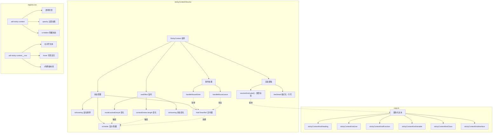
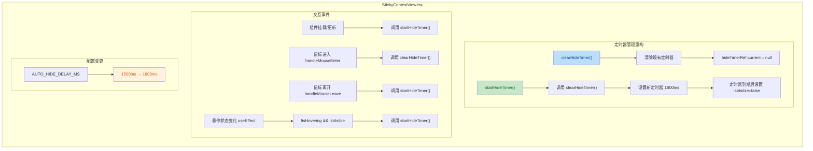

## 1. 高层摘要 (TL;DR)

*   **影响:** 🟡 **中等** - 重构了编辑器 Sticky Context 组件的交互逻辑和视觉设计
*   **关键变更:**
    *   ✨ 新增自动隐藏功能：1.5秒无操作后自动隐藏，鼠标悬停时暂停
    *   🎨 视觉设计重构：完全透明背景、右对齐文本、移除边框和阴影
    *   🌐 国际化支持：添加了 6 种上下文类型的中英文标签
    *   📝 文档更新：统一引号格式，更新设计规则说明

---

## 2. 可视化概览 (代码与逻辑图)



---

## 3. 详细变更分析

### 🎨 组件重构：Sticky Context 交互与视觉

**文件:** `ai-digital-life/frontend/src/app/regions/right-panel/stickyContextView.tsx`

**变更内容:**

#### 1. 新增自动隐藏逻辑
- **自动隐藏定时器:** 1.5秒无操作后自动隐藏 Sticky Context
- **鼠标悬停暂停:** 鼠标悬停时暂停隐藏计时器，离开后恢复
- **状态管理:** 新增 `isVisible`、`isHovering`、`hideTimerRef` 状态

#### 2. 国际化支持
- **新增 `resolveKindLabel()` 函数:** 将代码类型映射为本地化标签
- **行号格式化:** 从 `L123` 格式改为 `行 123`（中文）/ `Line 123`（英文）
- **类型标签支持:** 标题、行、函数、变量、类、接口

#### 3. 视觉布局调整
- **移除 `is-active` 类:** 不再高亮当前活动条目
- **图标位置调整:** "回到顶部"箭头图标内联显示在标签前
- **简化布局:** 移除独立的 kind 列，图标与标签合并

---

### 🎨 样式重构：透明设计与动画

**文件:** `ai-digital-life/frontend/src/styles/regions.css`

**变更内容:**

| 属性 | 旧值 | 新值 | 说明 |
|------|------|------|------|
| `background` | `var(--surface)` | `transparent` | 完全透明背景 |
| `border` | `1px solid var(--border-subtle)` | `none` | 移除边框 |
| `text-align` | `left` | `right` | 右对齐文本 |
| `grid-template-columns` | `3px 18px minmax(0, 1fr)` | `3px minmax(0, 1fr)` | 从3列简化为2列 |
| `box-shadow` | `inset 0 0 0 1px ...` | 无 | 移除边框阴影 |

**新增动画效果:**
```css
.adl-sticky-context {
  opacity: 1;
  transition: opacity 0.2s ease-out, visibility 0s linear 0.2s;
}

.adl-sticky-context.is-hidden {
  opacity: 0;
  pointer-events: none;
  visibility: hidden;
}
```

---

### 🌐 国际化文本扩展

**文件:** `ai-digital-life/frontend/src/app/copy.ts`

**新增翻译键值:**

| 键名 | 中文 | 英文 |
|------|------|------|
| `stickyContextKindHeading` | 标题 | Heading |
| `stickyContextKindLine` | 行 | Line |
| `stickyContextKindFunction` | 函数 | Function |
| `stickyContextKindVariable` | 变量 | Variable |
| `stickyContextKindClass` | 类 | Class |
| `stickyContextKindInterface` | 接口 | Interface |

---

### 🔧 组件集成更新

**文件:** 
- `ai-digital-life/frontend/src/app/regions/right-panel/ChangesPanel.tsx`
- `ai-digital-life/frontend/src/app/regions/right-panel/FilesPanel.tsx`

**变更内容:**
- 所有 `StickyContext` 组件调用处新增 `t={t}` prop 传递
- 共 3 处更新（ChangesPanel 1处，FilesPanel 2处）

---

### 📝 文档格式统一

**文件:** `ai-digital-life/docs/design-system/components.md`

**变更内容:**
- 统一引号格式：将中文引号 `""` 替换为英文引号 `""`
- 更新设计规则说明：
  - Sticky Context 自动隐藏行为（1.8秒无操作后隐藏）
  - 鼠标悬停暂停隐藏逻辑
  - 视觉设计：全透明背景、右对齐、无边框阴影

---

### ⚙️ 配置文件更新

**文件:** `.trae/.ignore` (新增)

**内容:**
```ignore
digitalLife/
trae-agentReviewBeforePushToRemote/
```

---

## 4. 影响与风险评估

### ⚠️ 潜在风险

| 风险项 | 影响 | 缓解措施 |
|--------|------|----------|
| **自动隐藏可能影响可用性** | 🟡 中 | 用户可能找不到上下文信息，需测试发现率 |
| **透明背景可读性问题** | 🟡 中 | 在不同编辑器主题下测试对比度 |
| **右对齐布局习惯改变** | 🟢 低 | 用户需要适应新的视觉布局 |

### ✅ 测试建议

1. **自动隐藏功能测试:**
   - 滚动编辑器，验证 Sticky Context 1.5秒后自动隐藏
   - 鼠标悬停在 Sticky Context 上，验证隐藏计时器暂停
   - 鼠标离开后，验证计时器恢复并正常隐藏

2. **国际化测试:**
   - 切换中英文界面，验证所有类型标签正确显示
   - 验证行号格式：`行 123` vs `Line 123`

3. **视觉设计测试:**
   - 在亮色/暗色主题下测试透明背景的可读性
   - 验证右对齐文本在不同内容长度下的显示效果
   - 测试 hover 状态的背景高亮是否足够明显

4. **回归测试:**
   - 验证 ChangesPanel 和 FilesPanel 的 Sticky Context 正常工作
   - 验证点击上下文条目仍能正确导航到对应位置

---

## 5. 变更总结

本次提交主要实现了 Sticky Context 组件的**交互体验优化**和**视觉设计重构**：

- 🎯 **核心目标:** 减少视觉干扰，提供更清爽的编辑体验
- 🚀 **技术实现:** 通过自动隐藏、透明背景、右对齐布局实现
- 🌍 **国际化支持:** 完整的中英文类型标签体系
- 📚 **文档同步:** 更新设计系统文档以反映新的交互规则

建议在合并前进行充分的用户测试，特别是自动隐藏功能的可用性验证。

---

## 1. 高层摘要 (TL;DR)

- **影响**: 🟡 中等 - 重构了粘性上下文组件的定时器管理逻辑，提升用户体验和代码质量
- **核心变更**:
  - ✅ 将自动隐藏延迟从 1500ms 增加到 1800ms，给用户更多阅读时间
  - ✅ 重构定时器管理，分离清除和启动逻辑，避免潜在内存泄漏
  - ✅ 移除重复代码，提升可维护性

---

## 2. 可视化概览 (代码与逻辑映射)



---

## 3. 详细变更分析

### 📦 组件: `StickyContext` (粘性上下文视图)

#### **变更类型**: 重构 + 用户体验优化

#### **核心逻辑变更**:

| 变更项 | 原实现 | 新实现 | 改进点 |
|--------|--------|--------|--------|
| **自动隐藏延迟** | 1500ms | 1800ms | 给用户多 300ms 阅读时间 |
| **定时器清除** | `resetHideTimer()` 仅清除 | `clearHideTimer()` 清除 + 置 null | 避免悬空引用 |
| **定时器启动** | 内联在多处 | 独立 `startHideTimer()` 函数 | 逻辑复用，减少重复 |
| **清理逻辑** | 多处重复清理 | 统一通过 `clearHideTimer()` | DRY 原则 |

#### **代码逻辑详解**:

**1️⃣ 定时器管理重构**

```typescript
// ❌ 旧实现：单一函数，职责不清
const resetHideTimer = useCallback(() => {
  if (hideTimerRef.current) {
    clearTimeout(hideTimerRef.current);
  }
}, []);

// ✅ 新实现：职责分离
const clearHideTimer = useCallback(() => {
  if (hideTimerRef.current) {
    clearTimeout(hideTimerRef.current);
    hideTimerRef.current = null;  // 关键：避免悬空引用
  }
}, []);

const startHideTimer = useCallback(() => {
  clearHideTimer();  // 先清理
  hideTimerRef.current = setTimeout(() => {
    setIsVisible(false);
    hideTimerRef.current = null;  // 清理引用
  }, AUTO_HIDE_DELAY_MS);
}, [clearHideTimer]);
```

**2️⃣ useEffect 依赖优化**

```typescript
// ❌ 旧实现：重复的清理逻辑
useEffect(() => {
  setIsVisible(true);
  resetHideTimer();
  
  return () => {
    if (hideTimerRef.current) {
      clearTimeout(hideTimerRef.current);  // 重复代码
    }
  };
}, [props.model.activeEntryId, props.model.contextEntries.length, resetHideTimer]);

// ✅ 新实现：复用 clearHideTimer
useEffect(() => {
  setIsVisible(true);
  startHideTimer();
  
  return clearHideTimer;  // 简洁且安全
}, [props.model.activeEntryId, props.model.contextEntries.length, startHideTimer, clearHideTimer]);
```

**3️⃣ 移除冗余 useEffect**

```typescript
// ❌ 旧实现：单独的清理 useEffect（不必要）
useEffect(() => {
  return () => {
    if (hideTimerRef.current) {
      clearTimeout(hideTimerRef.current);
    }
  };
}, []);

// ✅ 新实现：已移除（由其他 useEffect 的清理函数覆盖）
```

**4️⃣ 事件处理器简化**

```typescript
// ❌ 旧实现：内联清除逻辑
const handleMouseEnter = useCallback(() => {
  setIsHovering(true);
  if (hideTimerRef.current) {
    clearTimeout(hideTimerRef.current);
  }
}, []);

// ✅ 新实现：复用 clearHideTimer
const handleMouseEnter = useCallback(() => {
  setIsHovering(true);
  clearHideTimer();
}, [clearHideTimer]);
```

**5️⃣ 代码清理**

```typescript
// ❌ 移除未使用的变量
const kindLabel = isTop ? "" : resolveKindLabel(entry.kind, props.t);

// ✅ 新实现：已删除
```

---

## 4. 影响与风险评估

### ⚠️ 风险评估

| 风险项 | 级别 | 说明 |
|--------|------|------|
| **破坏性变更** | 🟢 无 | 纯内部重构，外部 API 未变 |
| **内存泄漏风险** | 🟢 降低 | 改进的 null 赋值逻辑减少泄漏可能 |
| **用户体验** | 🟢 改善 | 延长显示时间，减少误触发隐藏 |

### 🧪 测试建议

1. **定时器行为测试**:
   - ✅ 验证组件挂载后 1.8 秒自动隐藏
   - ✅ 验证鼠标悬停时定时器被清除
   - ✅ 验证鼠标离开后定时器重新启动

2. **边界情况测试**:
   - ✅ 快速连续切换 `activeEntryId`，验证定时器正确清理
   - ✅ 组件卸载时验证无定时器残留
   - ✅ 多次快速鼠标进出，验证无竞态条件

3. **回归测试**:
   - ✅ 确认上下文条目正常显示
   - ✅ 确认高亮状态正常切换
   - ✅ 确认点击交互正常工作

---

## 5. 总结

这次重构是一个**高质量的技术债务偿还**：
- 🎯 **目标明确**: 解决定时器管理混乱问题
- 🛡️ **安全提升**: 通过 `null` 赋值避免悬空引用
- 📖 **可读性提升**: 职责分离使代码意图更清晰
- 👥 **用户体验**: 延长显示时间，减少误操作

**推荐**: ✅ 可以合并，建议进行上述测试用例验证。

---

## 1. 高层摘要 (TL;DR)

*   **影响范围：** 🟢 **低** - 仅涉及单个 React 组件的性能优化
*   **核心变更：**
    *   🗑️ 删除未使用的 `resolveKindLabel` 函数
    *   ⚡ 将 `clearHideTimer` 从 `useCallback` 重构为 `useRef` 存储，减少不必要的函数重新创建
    *   📉 简化多个 `useCallback` 和 `useEffect` 的依赖数组

---

## 2. 可视化概览 (代码逻辑图)

```mermaid
graph TD
    subgraph "StickyContext 组件优化"
        direction TB
        
        subgraph "优化前"
            A1["clearHideTimer (useCallback)"] -->|依赖: []| B1["startHideTimer"]
            B1 -->|依赖: [clearHideTimer]| C1["useEffect 清理函数"]
            D1["handleMouseEnter"] -->|依赖: [clearHideTimer]| C1
            style A1 fill:#ffcdd2,color:#b71c1c
            style B1 fill:#ffcdd2,color:#b71c1c
            style C1 fill:#ffcdd2,color:#b71c1c
        end
        
        subgraph "优化后"
            A2["clearHideTimerRef (useRef)"] -->|稳定引用| B2["startHideTimer"]
            B2 -->|依赖: []| C2["useEffect 清理函数"]
            D2["handleMouseEnter"] -->|依赖: []| C2
            style A2 fill:#c8e6c9,color:#1a5e20
            style B2 fill:#c8e6c9,color:#1a5e20
            style C2 fill:#c8e6c9,color:#1a5e20
        end
    end
    
    subgraph "删除内容"
        E["resolveKindLabel 函数"] -.->|未使用| F["已被移除"]
        style E fill:#fff3e0,color:#e65100
        style F fill:#ffccbc,color:#bf360c
    end
```

---

## 3. 详细变更分析

### 📦 组件：`StickyContext` (React 组件)

**变更文件：** `ai-digital-life/frontend/src/app/regions/right-panel/stickyContextView.tsx`

#### 🗑️ 删除未使用函数

| 函数名 | 原用途 | 删除原因 |
|--------|--------|----------|
| `resolveKindLabel` | 将 kind 类型转换为本地化标签 | 代码中未被调用 |

#### ⚡ 性能优化：重构定时器清理逻辑

**问题背景：**
原实现使用 `useCallback` 创建 `clearHideTimer` 函数，虽然依赖数组为空 `[]`，但作为其他 `useCallback` 的依赖项时，仍可能导致不必要的函数重新创建。

**优化方案：**
使用 `useRef` 存储稳定的函数引用，避免依赖链中的级联重新创建。

| 项目 | 优化前 | 优化后 | 收益 |
|------|--------|--------|------|
| **clearHideTimer** | `useCallback(() => {...}, [])` | `clearHideTimerRef.current = () => {...}` | ✅ 引用稳定，永不变化 |
| **startHideTimer 依赖** | `[clearHideTimer]` | `[]` | ✅ 函数不会因依赖变化而重建 |
| **handleMouseEnter 依赖** | `[clearHideTimer]` | `[]` | ✅ 函数不会因依赖变化而重建 |
| **useEffect 清理** | `return clearHideTimer` | `return () => { clearHideTimerRef.current(); }` | ✅ 清理逻辑更明确 |
| **useEffect 依赖** | `[..., clearHideTimer]` | `[...]` | ✅ 减少一个依赖项 |

**代码对比：**

```typescript
// ❌ 优化前
const clearHideTimer = useCallback(() => {
  if (hideTimerRef.current) {
    clearTimeout(hideTimerRef.current);
    hideTimerRef.current = null;
  }
}, []);

const startHideTimer = useCallback(() => {
  clearHideTimer();  // 依赖 clearHideTimer
  hideTimerRef.current = setTimeout(() => {
    setIsVisible(false);
    hideTimerRef.current = null;
  }, AUTO_HIDE_DELAY_MS);
}, [clearHideTimer]);  // 依赖数组包含 clearHideTimer

// ✅ 优化后
const clearHideTimerRef = useRef<() => void>(() => {});
clearHideTimerRef.current = () => {
  if (hideTimerRef.current) {
    clearTimeout(hideTimerRef.current);
    hideTimerRef.current = null;
  }
};

const startHideTimer = useCallback(() => {
  clearHideTimerRef.current();  // 直接调用 ref 中的函数
  hideTimerRef.current = setTimeout(() => {
    setIsVisible(false);
    hideTimerRef.current = null;
  }, AUTO_HIDE_DELAY_MS);
}, []);  // 无依赖，引用稳定
```

---

## 4. 影响与风险评估

### ✅ 积极影响
*   **性能提升：** 减少了 `useCallback` 和 `useEffect` 的重新执行次数
*   **代码简化：** 移除了未使用的 `resolveKindLabel` 函数，减少代码体积
*   **依赖链优化：** 消除了 `clearHideTimer` 在依赖数组中的传递

### ⚠️ 潜在风险
*   **无破坏性变更：** 此重构完全向后兼容，不改变组件行为
*   **测试建议：**
  *   🔍 验证 StickyContext 的自动隐藏功能正常工作
  *   🔍 验证鼠标悬停时取消隐藏的逻辑
  *   🔍 验证 `activeEntryId` 或 `contextEntries.length` 变化时，组件正确重置定时器

### 📋 测试场景
| 场景 | 预期行为 |
|------|----------|
| 鼠标进入 StickyContext 区域 | 定时器被清除，组件保持可见 |
| 鼠标离开 StickyContext 区域 | 重新启动 `AUTO_HIDE_DELAY_MS` 延迟隐藏 |
| `activeEntryId` 变化 | 重置可见性状态并重新启动定时器 |
| `contextEntries.length` 变化 | 重置可见性状态并重新启动定时器 |

---

## 总结

本次变更是一次**纯粹的性能优化**，通过将 `useCallback` 替换为 `useRef` 存储函数引用，消除了不必要的依赖链，减少了 React 组件的重新渲染和副作用执行。同时清理了未使用的代码，提升了代码质量。建议进行基本的交互测试以确保功能正常。